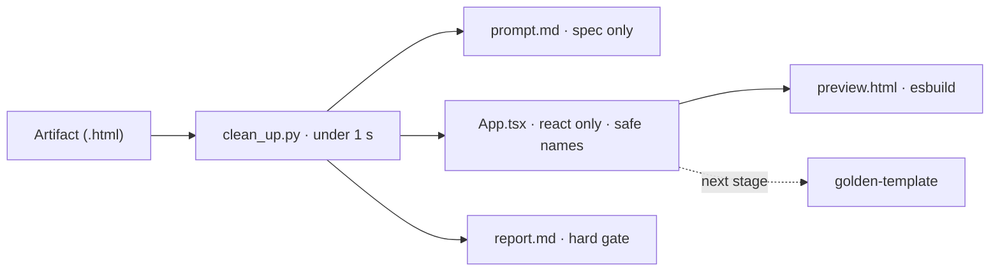

# Clean Up: artifact → one prompt + one pure React block

`clean-up` is the **pre-linter** in front of `golden-template`. It is built for speed and iteration: take what a chat just generated, strip everything that ties it to the tools that made it, normalize every name, and hand back two blocks you can paste into the next chat.

Everything lives in one script, [clean_up.py](scripts/clean_up.py): parsing, stripping, JSX conversion, naming, the hard gate, the prompt, the esbuild preview and the report.



## Workflow

1. Run the script on the artifact. No network, no npm install, no packaging:
   ```bash
   python3 {skill_dir}/scripts/clean_up.py path/to/page.html --name my-view
   ```
   Output goes to `clean-up/my-view/` next to the input: `App.tsx`, `prompt.md`, `preview.html`, `report.md`. The exit code is 0 only when every check passes.
2. Read `report.md`. Every check must be ✅.
   - **Vendor names** in page copy (ChatGPT, Jetski, Argon, REF-NN): re-run with `--fix` to swap in golden-template's neutral terms.
   - **Tool or library names** in page copy (for example a page titled "shadcn Chat"): rename that copy in the source page and run again.
   - **Single-character class or id names** that cannot be renamed from their CSS: give them a meaningful name in the source page and run again.
   - Generic words such as "MCP" or "registry" are warnings only, because they can be real product copy.
3. Show the user both blocks **inline** (the prompt in full; the TSX in full or its top plus structure if it is very long) and stage `preview.html` as an artifact so it renders immediately.
4. **Iterate**: the user pastes the prompt or the TSX into another chat, changes it, and the result can be cleaned up again. Each run is idempotent.

## What it guarantees

| Output | Contract |
| :-- | :-- |
| `prompt.md` | Title, design tokens, fonts, landmark outline with copy, tables and chart labels, behavior, breakpoints, acceptance criteria. No tool, vendor, registry or path names. |
| `App.tsx` | One file. `export function App()` plus `export default App`. Imports only `react`. CSS is a `STYLES` string rendered in a `style` element. Icons are an inline `ICONS` map plus an `Icon` component. No comments. |
| `preview.html` | Self-contained bundle (React inlined) built from `App.tsx`, for the artifact pane. |
| `report.md` | Pass/fail table, every rename (before → after), warnings, and the golden-template handoff checklist. |

## Naming hard gate (Google style, React / React Native safe)

| Thing | Convention | Example |
| :-- | :-- | :-- |
| CSS classes, element ids | lowercase kebab-case, starts with a letter, no cryptic abbreviations | `sb-head` → `sidebar-head`, `btn-new` → `button-new`, `xAxis` → `x-axis` |
| Single-character classes | renamed from their only CSS declaration, otherwise **fail** | `.r { text-align: right }` → `text-align-right` |
| data-* attributes, CSS custom properties | lowercase kebab-case | `data-toggle`, `--muted-foreground` |
| Components / constants / variables | UpperCamelCase / CONSTANT_CASE / lowerCamelCase | `App`, `Icon` / `STYLES`, `ICONS` / `didInitRef` |
| Icon keys | lowerCamelCase bare identifiers, never reserved words | `i-search` → `search`, `delete` → `deleteIcon` |
| Output | kebab-case slug folder, plus a React Native project name | `clean-up/dashboard-3/` → RN `Dashboard3` |

Renames are applied consistently to markup, CSS selectors, JS string selectors, ARIA id references, `href="#id"` and `url(#id)`. Full rules: [references/contract.md](references/contract.md). Worked example: [examples/dashboard-3.md](examples/dashboard-3.md).

## Fast vs. idiomatic behavior

- **Fast (default, scripted)**: page behavior is carried over verbatim inside one guarded `useEffect`, so the output runs exactly like the source with zero model work.
- **Idiomatic (on request, model step)**: rewrite that effect into `useState` and handlers (sidebar open, tabs, menus) so strict `tsc` passes. Do this only when the user asks or before golden-template packaging, then re-run step 1 on the result's preview to confirm.

## Handoff to golden-template

`clean-up` never scaffolds folders or `package.json`. When the user is ready to package, follow the checklist at the bottom of the report: split sections into `src/components`, move data into `src/data`, move `STYLES` into `src/index.css`, port the behavior, then run `lint-golden-template.mjs --fix`.

## Contributions

Keep this skill fast (no network, no installs, under 2 seconds per page) and in one script. Add new stripping, conversion or naming rules to `scripts/clean_up.py` with a matching line in `references/contract.md`.
