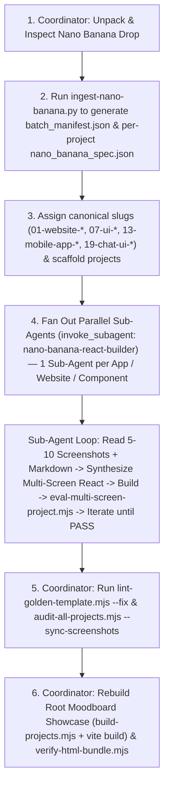

# Sub-Agent Parallel Execution Runbook for Nano Banana Batches

This runbook defines the **parallel sub-agent orchestration protocol** for converting an entire **Nano Banana** batch (**8+ Apps**, **8+ Website Landing Pages with sub-pages**, and **UI Components**, each with **5–10 screenshots**, metadata, and markdown) into canonical Google Golden Template React 19 + Vite 7 + Tailwind v4 deliverables inside `<moodboard>/projects/<NN>-<category>-<descriptor>/`.

---

## 1. Orchestration Overview

When a Nano Banana batch file/archive/directory arrives:



---

## 2. Phase 1: Coordinator Ingestion & Slug Assignment

Before spawning sub-agents, the coordinator runs **once**:

1. **Unpack & Run Batch Ingestion**:
   ```bash
   python3 /usr/local/google/home/jfesta/skills/image-to-react/scripts/ingest-nano-banana.py \
     --input-dir "<path-to-nano-banana-input>" \
     --out-dir "<scratch-dir>/nano-banana-specs"
   ```
   This produces:
   - `<scratch-dir>/nano-banana-specs/batch_manifest.json` listing every discovered App, Website Landing Page, and Component along with its screen count (`5..10`), primary viewport, and spec path.
   - `<scratch-dir>/nano-banana-specs/<project-slug>/nano_banana_spec.json` containing per-screen color palettes, 12×8 cell maps, horizontal band segmentations, and reference PNG paths.

2. **Enforce Mandatory Nomenclature Mapping**:
   Every project slug inside `<moodboard>/projects/` **MUST** follow the 4 canonical category prefixes:
   - **Website Landing Pages (with sub-pages/sections)**: `01-website-<descriptor>` .. `06-website-<descriptor>` (or sequential `NN-website-<descriptor>`) → Title: `Website Landing Page — <Title>`
   - **UI Components**: `07-ui-<descriptor>` .. `12-ui-<descriptor>` (or sequential `NN-ui-<descriptor>`) → Title: `UI Component — <Title>`
   - **Mobile Apps / Full Application Flows**: `13-mobile-app-<descriptor>` .. `18-mobile-app-<descriptor>` (or sequential `NN-mobile-app-<descriptor>`) → Title: `Mobile App UI — <Title>`
   - **Chat / Assistant UIs**: `19-chat-ui-<descriptor>` .. `23-chat-ui-<descriptor>` (or sequential `NN-chat-ui-<descriptor>`) → Title: `Chat UI — <Title>`
   - **Zero Forbidden Terms**: Never include `Jetski`, `ChatGPT`, `Argon`, `gemini-4-argon`, `REF-0xx`, or `index-7.html`.

3. **Pre-Scaffold Project Directories & Shared `node_modules` Links**:
   Run [`scripts/scaffold-golden-from-image.mjs`](../../image-to-react/scripts/scaffold-golden-from-image.mjs) for each target project so that every sub-agent works inside an isolated `<moodboard>/projects/<slug>/` directory with `node_modules` already linked to the moodboard root. This prevents `npm install` contention across parallel sub-agents.

---

## 3. Phase 2: Defining & Invoking `nano-banana-react-builder` Sub-Agents

### 3.1 Sub-Agent Definition (`define_subagent`)
Register the dedicated builder sub-agent type `nano-banana-react-builder` with `EnableWriteTools: true`:
- **Name**: `nano-banana-react-builder`
- **Description**: `Synthesizes, builds, visually evaluates (across 5-10 reference screenshots), and polishes a single Nano Banana App, Website Landing Page, or UI Component into a pixel-perfect Google Golden Template React 19 + Vite 7 + Tailwind v4 package.`

### 3.2 Isolation Rules for Parallel Sub-Agents
- Each sub-agent owns **strictly one project directory**: `<moodboard>/projects/<slug>/` and its dedicated evaluation output directory `<scratch-dir>/eval/<slug>/`.
- Sub-agents **must not** edit files outside their assigned `<moodboard>/projects/<slug>/` folder or run global moodboard builds until the coordinator collects all completions.
- All commands (`vite build`, `eval-multi-screen-project.mjs`, `lint-golden-template.mjs`) run inside `BypassSandbox: false`.

### 3.3 Canonical Sub-Agent Prompt Template

When invoking `invoke_subagent` for each App, Website Landing Page, or Component, pass a prompt structured as follows:

```markdown
You are assigned to build, visually evaluate, and polish the Golden Template React 19 + Vite 7 + Tailwind v4 deliverable:
- **Project Slug**: `<slug>`
- **Project Title**: `<Category Label> — <Project Title>`
- **Target Project Directory**: `<moodboard-path>/projects/<slug>`
- **Nano Banana Multi-Screen Spec JSON**: `<scratch-dir>/nano-banana-specs/<slug>/nano_banana_spec.json`
- **Evaluation Output Directory**: `<scratch-dir>/eval/<slug>`

### Required Reading & Instructions
1. Read `/usr/local/google/home/jfesta/skills/image-to-react/references/nano_banana_multi_screen_protocol.md`
2. Read `<scratch-dir>/nano-banana-specs/<slug>/nano_banana_spec.json`
3. Use `read_file` to visually inspect **every single reference screenshot** (`screens[0].reference_png` .. `screens[N-1].reference_png`) and any markdown/metadata files listed in `nano_banana_spec.json`.

### Implementation Requirements
1. **Exact Golden Template Structure**:
   - Maintain canonical `package.json`, `tsconfig.json`, `vite.config.ts`, `index.html` (with `#gt-inspector-host` standalone Code Inspector script), `src/main.tsx`, `src/index.css`, `src/App.tsx`, `src/components/`, `src/data/`, and `src/utils/cn.ts`.
   - Zero forbidden vendor/internal strings (`Jetski`, `ChatGPT`, `Argon`, `REF-0xx`, `index-7.html`).
2. **Multi-Screen Evaluation Contract**:
   - Synthesize all `N` screens from the reference screenshots (`screens[0]` .. `screens[N-1]`) as modular components in `src/components/` backed by typed data in `src/data/<domain>Data.ts`.
   - Wire `?screen=<index>` & `?screenId=<id>` URL parameters on initial load AND register `window.__setGoldenEvalScreen = (index, screenId) => ...` in `src/App.tsx`.
   - Wire interactive navigation (tabs, nav links, step buttons, cards, modals) so users can click between all screens and interact with filters/controls within each screen.
   - If you add a floating screen-switcher pill bar that is not part of the reference screenshot, give it `className="gt-eval-hide"` so it is hidden during 1:1 pixel evaluation.
3. **Pixel-Perfection & Craft Invariants**:
   - Match exact background/surface/ink/accent hex colors from `nano_banana_spec.json`.
   - Transcribe all visible headlines, labels, metrics, prices, and body copy verbatim.
   - Ensure `tabular-nums` on all numeric values.
   - Ensure symmetrical button padding (`px-3.5` to `px-5`, `|paddingLeft - paddingRight| <= 6px`, `|paddingTop - paddingBottom| <= 4px`).
   - Ensure equal card heights (`h-full flex flex-col justify-between`) across multi-column grids.
   - For photographic/illustrated/chart regions in the reference screenshots, either crop/embed the exact visual region from the source image or construct a high-craft SVG/Canvas visual matching its exact bounding box and color distribution.

### Build & Multi-Screen Visual Evaluation Loop (Run in `BypassSandbox: false`)
1. Build the project:
   `npm --prefix "<moodboard-path>/projects/<slug>" run build`
2. Run the strict multi-screen evaluator across all reference screenshots:
   `node /usr/local/google/home/jfesta/skills/image-to-react/scripts/eval-multi-screen-project.mjs --project="<moodboard-path>/projects/<slug>" --spec="<scratch-dir>/nano-banana-specs/<slug>/nano_banana_spec.json" --out-dir="<scratch-dir>/eval/<slug>" --target-score=0.85 --min-screen-score=0.82`
3. Inspect `<scratch-dir>/eval/<slug>/multi_screen_eval_report.json` and view `side_by_side_<id>.png` / `diff_mask_<id>.png` for any screen below `0.85` or with any DOM violation.
4. Iterate on your React components and CSS until `overall_passed: true` (`mean_s_total >= 0.85`, `min_s_total >= 0.82`, `0` collisions, `0` clipped text, `0` broken images, `0` button padding violations, `0` grid equality violations).
5. Return a concise summary with per-screen `s_total` scores and confirmation that `tsc --noEmit` and `eval-multi-screen-project.mjs` passed.
```

---

## 4. Phase 3: Coordinator Aggregation, Linting & Moodboard Sync

Once all parallel sub-agents report completion:

1. **Run the Universal Golden Template Linter Across the Moodboard**:
   ```bash
   node /usr/local/google/home/jfesta/skills/golden-template/scripts/lint-golden-template.mjs \
     --dir="<moodboard-path>" --fix
   ```
2. **Run the Batch DOM & Craft Auditor + Sync 1:1 Screenshots**:
   ```bash
   node /usr/local/google/home/jfesta/skills/image-to-react/scripts/audit-all-projects.mjs \
     --dir="<moodboard-path>" --sync-screenshots
   ```
3. **Rebuild the Moodboard Gallery & All Standalone Deliverable Bundles**:
   ```bash
   cd "<moodboard-path>" && node scripts/build-projects.mjs && npx vite build
   ```
4. **Verify Every Built HTML Bundle (`0` syntax/leak/CORS errors)**:
   ```bash
   node "<moodboard-path>/scripts/verify-html-bundle.mjs" "<moodboard-path>/dist/index.html"
   ```
