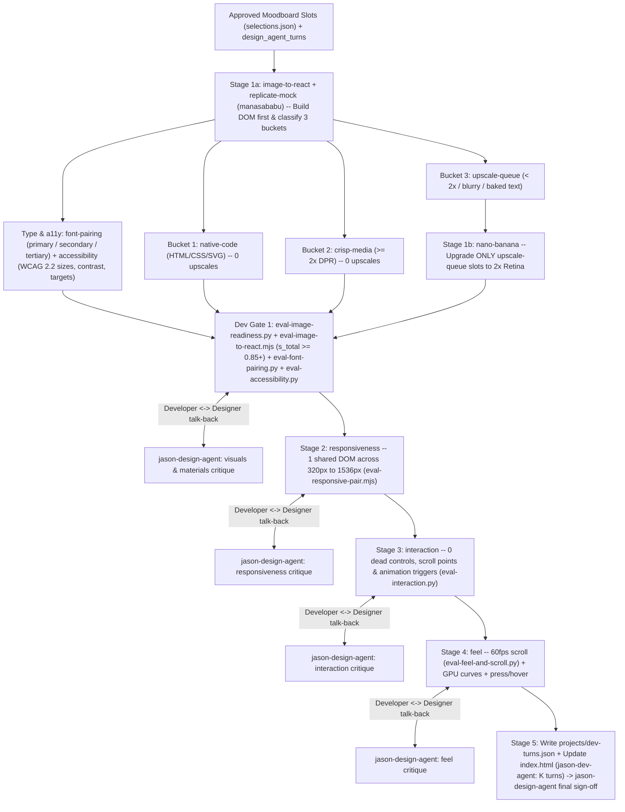

# image to react

```text
jason-dev-agent / image to react
────────────────────────────────────────────────────────────────────
stage         master pipeline + stage 1 visual & structural lock
sub-skills    replicate-mock · nano-banana · font-pairing · accessibility · responsiveness · interaction · feel · design-critique
dev eval      s_total >= 0.85+, 0 collisions/overflow, button & grid craft
paired gate   every passed dev eval triggers design-critique in jason-design-agent
```

`image-to-react` is `jason-dev-agent`'s top-level pipeline for turning a reference image (or multi-screen 4K grid) into a Golden Template (`dating`) React 19 + Vite 7 + Tailwind v4 build. It runs Stage 1's iterative **screenshot-to-screenshot dev eval** and coordinates six focused companion skills—upscaling low-res plates via `nano-banana`, stopping at every stage to pass the **dev eval** first, and then sending that **same stage back into `jason-design-agent` as a designer critique** against the original inspiration.

---

## 1. the image-to-react skill chain (`jason-dev-agent` <-> `jason-design-agent`)



Full cross-stage rules live in [paired dev and design eval pipeline](references/paired_dev_and_design_eval_pipeline.md):

1. **`image-to-react` + `replicate-mock`** (*stage 1a — dom synthesis & 3-bucket classification first*): builds the Golden Template React DOM shell (`src/data/`, `src/components/`, `src/App.tsx`) using `replicate-mock` (credited to Manasa Babu, `manasababu`) and classifies every visual region into **three developer buckets** *before* any upscaling runs:
   - **`native-code` (`html / css / inline svg`)** — buttons, pills, navbars, cards, borders, gradients, typography, geometric icons -> **0 raster upscales**.
   - **`crisp-media` (`>= 2x` DPR already)** — raster regions that already pass `eval-image-readiness.py` at their actual mounted CSS dimensions -> **0 upscales**.
   - **`upscale-queue` (`< 2x` DPR, blurry, or baked-in text over photo)** — *only* the mounted `` slots flagged by `eval-image-readiness.py` against their real rendered `clientWidth x clientHeight`.
1b. **`font-pairing` + `accessibility`** (*stage 1a type system & accessible sizing*): assign the `style-direction` families to **primary** (headlines + subheadlines), **secondary** (body + UI), optional **tertiary** accent (`<= 15%`), wire one modular scale, and size type/controls to WCAG 2.2 (body `>= 16px` / `1.5`, contrast `4.5:1`, targets `>= 24x24`, focus rings, names, alt, lang) -> pass `eval-font-pairing.py` + `eval-accessibility.py` (re-run after stages 2–4).
2. **`nano-banana`** (*stage 1b — targeted bucket upgrade & non-blur readiness eval*): upgrades **only `upscale-queue` slots** to exact `2 * clientWidth x 2 * clientHeight` `2x` Retina plates with zero drift, passes `eval-image-readiness.py --project=...` (`0` blurry or `< 2x` images) + `eval-image-to-react.mjs` (`s_total >= 0.85+`, `0` DOM/button/grid violations) -> **then runs `design-critique` (`visuals` + `materials`) in `jason-design-agent`**.
3. **`responsiveness`** (*stage 2 — viewports & reflow*): tunes one shared semantic DOM across desktop, mobile, and the 6-viewport continuum (`320px -> 1536px`) via `eval-responsive-pair.mjs` until passing -> **then runs `design-critique` (`responsiveness`) in `jason-design-agent`**.
4. **`interaction`** (*stage 3 — buttons, sliders, pagination, scroll points & animation triggers*): ensures 100% of elements work (`0` dead controls), wires sliders, pagination/filters, `IntersectionObserver` **scroll points**, and explicit **animation triggers** while keeping `t=0` locked -> **then runs `design-critique` (`interaction`) in `jason-design-agent`**.
5. **`feel`** (*stage 4 — `60fps` scroll, tactile physics & gpu curves*): verifies **`60fps` scrolling** (`eval-feel-and-scroll.py`), `:active`/`:hover` physics, GPU `transform`/`opacity` curves, `0` layout shift, and `prefers-reduced-motion` until passing -> **then runs `design-critique` (`feel` + `final-signoff`) in `jason-design-agent`**.
6. **`design-critique`** (*paired developer <-> designer loop*): sends every passed dev eval from `jason-dev-agent` (speaking strictly as a developer with DOM/CSS/eval metrics) back into `jason-design-agent` against the original inspiration, recording total `jason-dev-agent` turns in `projects/dev-turns.json` and the moodboard `Development` view (`<study-slug>/index.html`).

---

## 2. bundled references & scripts

### references (`references/`)
- [paired `jason-dev-agent` <-> `jason-design-agent` pipeline](references/paired_dev_and_design_eval_pipeline.md) — how all stages stop for dev eval first, then run mirrored designer critiques.
- [visual rubric & iterative screenshot eval loop](references/visual_rubric_and_eval_loop.md) — `s_total` formula, Top/Middle/Bottom 3-zone scan, 50/50 overlay + 64x64 diff heatmap, and `p0 -> p1 -> p2` remediation.
- [button padding, micro-spacing & equal grid rules](references/button_padding_and_grid_equality.md) — symmetrical button/pill padding, container clearance, `minmax(0, 1fr)` equal grid tracks, and `<= 2px` bottom baseline alignment.
- [golden template (`dating`) & inspector architecture](references/dating_golden_template_architecture.md) — canonical config parity, 3-tier `src/` layout, nomenclature rules, and standalone inspector.
- [4k website upgrade & competitor benchmarks](references/four_k_upgrade_and_competitor_benchmarks.md) — category benchmark mapping, `2x` Retina `gempix-1` de-dithering, Veo looping video posters, Base64 WOFF2 fonts, and `s_total >= 0.93+` lock.
- [dual-authority responsive lock & 60fps media stack](references/avela_dual_authority_and_60fps_media_stack.md) — desktop + mobile dual authority, off-main-thread `VIDEO_BLOB_CACHE`, pre-stacked swatch crossfades, and GPU-clean scroll settles.
- [nano banana multi-screen protocol](references/nano_banana_multi_screen_protocol.md) — `?screen=<i>` and `window.__setGoldenEvalScreen` contract across 5-10 screens per entity.
- [parallel sub-agent execution runbook](references/subagent_parallel_execution_runbook.md) — batch fan-out protocol for multi-project runs.
- [google3 image-to-react lineage](references/google3_image_to_react_lineage.md) — upstream tool & skill lineage.

### executable scripts (`scripts/`)
- [`scripts/eval-image-to-react.mjs`](scripts/eval-image-to-react.mjs) — builds the React project, renders `rendered.png` at exact reference dimensions in headless WebKit2GTK, generates `rendered_overlay.png` (50/50 blend), `diff_mask.png` (64x64 loss heatmap), and `side_by_side.png`, audits DOM collisions, button padding symmetry, and grid equality, and writes `visual_match_audit.json`.
- [`scripts/eval-multi-screen-project.mjs`](scripts/eval-multi-screen-project.mjs) — evaluates all 5-10 screens of a multi-screen build via `?screen=<i>` and `window.__setGoldenEvalScreen`, enforcing `mean_s_total >= 0.85`, `min_s_total >= 0.82`, and `0` craft violations.
- [`scripts/ingest-nano-banana.py`](scripts/ingest-nano-banana.py) — batch preprocessor and 8-token semantic palette extractor for multi-screen folders.
- [`scripts/scaffold-golden-from-image.mjs`](scripts/scaffold-golden-from-image.mjs) — scaffolds a clean `projects/<slug>/` package from `golden-template/assets/dating/`.

---

## 3. stage 1 execution & self-judging dev eval

### step 0 — prompt user for `jason-design-agent` turn count *(testing mode)*
Before running the pipeline (unless the user already specified a number in their prompt), ask the user **"how many turns do you want out of the design agent?"** (using `ask_question` with options `1`, `2 (Recommended)`, `3`, or `until approved`, plus free-entry custom `N`). Store `design_agent_turns` and apply it across every `design-critique` handoff in the chain (`image-to-react`, `responsiveness`, `interaction`, and `feel`).


### step 1 — build react dom shell, classify 3 buckets & upgrade only `upscale-queue` slots
1. Inspect the reference plate via `read_file` alongside `jason-design-agent`'s direction (`style-direction/` & `research/`).
2. Extract exact sampled hex tokens (`--surface`, `--surface-raised`, `--ink`, `--muted`, `--accent`, `--accent-alt`, `--on-accent`, `--border`) and pixel coordinates with `replicate-mock`, then scaffold `projects/<slug>/` from `golden-template/assets/dating` (`src/data/*Data.ts`, `src/components/*.tsx`, `src/App.tsx`).
3. Partition every visual element into **3 developer buckets** before running any image upscaling:
   - **`native-code` (`html / css / svg`)**: rebuild all buttons, inputs, cards, navbars, gradients, and crisp icons natively (**0 raster upscaling**).
   - **`crisp-media` (`>= 2x` DPR)**: mount already-sharp high-res crops directly (**0 upscaling**).
   - **`upscale-queue` (`< 2x` DPR / blurry / baked text)**: run `eval-image-readiness.py --project=...` to measure each `` against its actual mounted CSS box (`clientWidth x clientHeight`), then pass **only failing `upscale-queue` slots** through `nano-banana` for exact `2 * clientWidth x 2 * clientHeight` restoration.
4. Record every `jason-dev-agent` iteration in `projects/dev-turns.json` and surface `jason-dev-agent: <K> turns` in the `Development` view of `<study-slug>/index.html`.

### step 2 — micro-craft invariants (enforced before & during eval)
- **button & pill optical symmetry**: balanced `padding-left` / `padding-right` (`px-3.5 py-1.5` compact pills, `px-4 py-2` secondary buttons, `px-5 py-2.5` or `px-6 py-3` primary CTAs), `gap-1.5` to `gap-2` icon gaps, `whitespace-nowrap shrink-0`, `tabular-nums` on numbers, and `>= 12px` card bottom clearance.
- **equal grid geometry**: `grid-template-columns: repeat(N, minmax(0, 1fr))`, `min-w-0` on children, `h-full flex flex-col` + `mt-auto` on sibling cards so bottom borders align within `<= 2px`.

### step 3 — stop & judge: run `eval-image-to-react.mjs` over turns

```bash
# 1. lint config parity & strict typescript against golden-template/assets/dating
/usr/local/google/home/jfesta/.local/bin/node \
  /usr/local/google/home/jfesta/design-kit/skills/golden-template/scripts/lint-golden-template.mjs \
  --dir=/path/to/workspace \
  --project=<project-slug> --fix

# 2. verify all mounted images are loaded, >= 2x retina, and non-blurry
python3 /usr/local/google/home/jfesta/design-kit/skills/nano-banana/scripts/eval-image-readiness.py \
  --project="/path/to/workspace/projects/<project-slug>"

# 3. lock the type system (primary / secondary / tertiary) and accessible sizes
python3 /usr/local/google/home/jfesta/design-kit/skills/font-pairing/scripts/eval-font-pairing.py \
  --project="/path/to/workspace/projects/<project-slug>" --expect-primary="<family>" --expect-secondary="<family>"
python3 /usr/local/google/home/jfesta/design-kit/skills/accessibility/scripts/eval-accessibility.py \
  --project="/path/to/workspace/projects/<project-slug>"

# 4. run the stage 1 image-to-react dev eval
/usr/local/google/home/jfesta/.local/bin/node \
  /usr/local/google/home/jfesta/design-kit/skills/image-to-react/scripts/eval-image-to-react.mjs \
  --reference="/path/to/reference.png" \
  --project="/path/to/workspace/projects/<project-slug>" \
  --out-dir="/tmp/image_to_react_eval_<project-slug>"
```

Inspect `rendered.png`, `rendered_overlay.png`, `diff_mask.png`, and `visual_match_audit.json` via `read_file` across Top (`0-25%`), Middle (`25-75%`), and Bottom (`75-100%`) zones. Iterate `p0 -> p1 -> p2` fixes (up to 4-6 turns) until all Stage 1 dev gates pass:
- `s_total >= 0.85` (`>= 0.93` for 4K studio lock)
- `collision_count == 0`
- `horizontal_overflow_px == 0`
- `clipped_text_count == 0`
- `button_padding_violations == 0`
- `grid_equality_violations == 0`
- `eval-font-pairing.py`: `family_budget_ok`, `primary_locked_ok`, `secondary_locked_ok`, `tertiary_restrained_ok`, `scale_ok`
- `eval-accessibility.py`: `contrast_ok`, `text_size_ok`, `line_height_ok`, `target_size_ok`, `focus_visible_ok`, `accessible_names_ok`, `img_alt_ok`, `lang_ok`

### step 4 — paired visuals critique (`jason-design-agent`) -> advance chain -> final `jason-design-agent` output
Immediately after Stage 1's dev eval passes:
1. Run `design-critique` (`stage: image-to-react / visuals`) back into `jason-design-agent` with `side_by_side.png` and the original inspiration until visuals are approved.
2. Advance through **`responsiveness`**, **`interaction`**, and **`feel`**, talking back to `jason-design-agent` (`design-critique`) whenever needed and after each passed dev eval.
3. **Final end-to-end handback to `jason-design-agent`**: once `jason-dev-agent` finishes all build stages, hand the completed build and renders back to **`jason-design-agent`** so `jason-design-agent` emits the **mandatory final designer critique & sign-off output (`critique/final-design-signoff.md`)**.

--------------------------------------------------------------------------------

## Credits & Lineage

Built by Jason Festa (`jfesta`) integrating upstream Google3 skills and verifiers documented in [google3 image-to-react lineage](references/google3_image_to_react_lineage.md): **`replicate-mock`** (Manasa Babu, `manasababu`), **`screenshot-to-html` & `visual-matcher` (`AutoRaterV1`)** (Google Agentic Design Loop: `dfreedm`, `jonathangamble`, `meaplet`, `igormr`), **`screenshot-to-search-vibes` & `html-to-search-vibes`** (Google Cruxy: `zaneriley`, `dfreedm`, `darrenhead`, `jordanfine`, `bevc`), **`sds-measurement-verifier`** (Google Search DevAI SDS: `sskhandp`, `str`), **`screenshot-compare`** (Google Search DevAI Aegis), **`clone-check` & `figma-to-react`** (Minko Gechev `mgechev` & Selene), and **`hifi-mockup`** (Google Stitch / Gemini Prototyping).

## Contributions

To contribute or modify this skill or its references, follow the
[contribution guidelines](references/contributing.md) before making changes.
