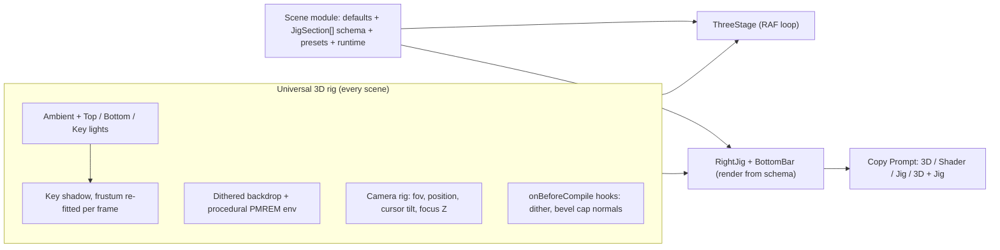

# 3D UI Jig (`3d-ui-jig`): universal rig + scene modules + schema-driven jig

A drop-in kit for **interfaces that use 3D**, not photoreal scenes. A WebGL stage renders 3D UI (cards, slabs, tiles carrying CanvasTexture UI). A right-hand jig tunes every parameter live, and a bottom dock exports what you tuned as build prompts.

```bash
python3 ~/design-kit/skills/3d-ui-jig/scripts/init_3d_ui_jig.py <golden-template-project> --scene cuboid-chain   # or --scene blank
cd <project> && npm install && npx tsc --noEmit && npx vite build
```

The script copies typed source into `src/`, replaces `App.tsx` (the old one is saved as `App.tsx.bak`), adds `three` + `@types/three` to `package.json` (the Golden Template's one explicit 3D dependency exception), and adds the Instrument Sans + JetBrains Mono Google Fonts link to `index.html` if the project doesn't already load them. Then it prints the next steps. Use `--dry-run` to preview, `--overwrite` to refresh files you've already scaffolded, and `--no-package-edit` / `--no-html-edit` to skip those edits.

## 1. Architecture



### Universal 3D rig (`src/three/rig/`), reused by every scene
- **Lights** (`createRig.ts`): an AmbientLight plus three DirectionalLights. **Top** and **Bottom** are fills with no shadow. **Key** casts the shadow, and its orthographic shadow camera is **re-fitted every frame** to the visible width plus padding, so shadows stay crisp at any camera Z. Bias, normal bias and blur radius scale with the shadow map size.
- **Backdrop**: an 80×50 plane with a dithered MeshStandardMaterial that receives shadows and has its own roughness, metalness and env intensity.
- **Environment** (`envMaps.ts`): ten offline procedural PMREM presets (studio, city, apartment, warehouse, dawn, forest, lobby, night, park, sunset). Each is a gradient dome plus softbox panels, so there are no HDRI fetches.
- **Camera rig** (`cameraRig.ts`): fov and position, look-at-origin, and exponential cursor-follow tilt. A scene can override the camera Z (focus mode) and fade the tilt out through `FrameDirectives`.
- **Shader hooks** (`shaderHooks.ts`): composable `onBeforeCompile` string patches over stock MeshStandardMaterial:
  - `ditherHook`: screen-space hash dither after `<colorspace_fragment>`, which kills banding on dark matte gradients.
  - `capNormalSofteningHook`: bends the front and back cap normals near the bevel toward ±Z and exports `vFrontBlend`, so card art shows only on the +Z face and fades across the bevel.
  - `patchStandardMaterial(material, hooks, cacheKey)` composes the hooks and returns the merged uniforms.
- **Schema** (`rigSchema.ts`): the Lights (with Top / Bottom / Key sub-groups), Shadows, Backdrop and Camera jig sections.
- **Renderer** (`components/ThreeStage.tsx`): antialias, dpr ≤ 2, PCFShadowMap with `shadow.radius` blur (PCFSoftShadowMap is deprecated in three r18x), ACESFilmic tone mapping, sRGB output.

### Scene module (`src/three/scenes/<id>/`)
A scene module is one object that satisfies `SceneModule<P>` (`scenes/types.ts`):

| Field | What it is |
| :--- | :--- |
| `defaults: P` | Typed scene params |
| `schema: JigSection[]` | Declarative controls with paths rooted at `scene.`: `slider`, `color`, `toggle`, `select`, `text`, and `group` (sub-group) |
| `rigDefaults`, `presets`, `defaultPresetName` | Deep-partial overrides of `{ rig, scene }` |
| `dock` | Bottom-bar items: `segmented`, `play-pause`, `preset`, `reset-view` |
| `persistPaths` | Values that survive preset switches and Reset (e.g. `scene.cards`) |
| `ExtraSection` | Optional free-form jig fold for things a schema can't express, such as array editing |
| `prompt.elements`, `prompt.shader`, `shaderSnippets` | Prose and GLSL for Copy Prompt, with live values interpolated |
| `create(ctx, params)` | Imperative runtime. `preFrame` runs before the camera update (hover raycast, focus, camera overrides). `update` runs after it (animate meshes, set uniforms). Also `onParamsChange`, `onClick`, `onPointerLeave`, `onReset`, `dispose` |

**`cuboid-chain`** is the first module. It's an infinite tiled row of beveled ExtrudeGeometry cuboids, and it can also form a helix, ring, wave or arch. Each cuboid's front cap carries 540×756 content and hover CanvasTextures. Hovering faces a card to the camera and swaps in the accent hover state. Clicking flies the card into focus. A Card Content editor sits in the jig. Full spec: [references/cuboid-chain-spec.md](references/cuboid-chain-spec.md).

**`blank`** gives you the rig and jig with one placeholder slab and an empty schema. It's the starting point for a new module: [references/new-scene-module.md](references/new-scene-module.md).

### Schema-driven jig (`src/components/jig/`)
- **`RightJig`**: DialKit style, fixed top-right, 308px wide. The header has the title, a preset select, **Copy JSON**, **Reset** and **Collapse**. The body has one collapsible fold per `JigSection`. Scene sections come first, then the rig sections, then the module's `ExtraSection`. Sliders scrub, take a typed value when you click the number, and step with the arrow keys (Shift steps ×10). Colors use a swatch plus a hex field.
- **`BottomBar`**: renders the module's `dock`, an **Edit** button when the module has an `ExtraSection`, and the **Copy Prompt** menu.
- **`useJigState`**: holds the values, presets, `setValue(path, v)`, `setScene`, reset, reset view and the reset signal.
- **`?nojig=1`** hides all the jig chrome, for clean 1:1 captures.

### Copy Prompt exporter (`promptExport.ts`)
`buildPrompt(kind, module, sections, values, presetName)` turns the schema, the live values and the shader snippets into four self-contained prompts:

| Kind | What it contains |
| :--- | :--- |
| **3D Elements** | The module's `prompt.elements` plus the camera, backdrop, env and renderer |
| **Shader** | The module's `prompt.shader`, light and shadow values, and the rig and scene GLSL, quoted verbatim |
| **Right-Hand Jig** | Generated from the schema: every section and control with its type, range, step and current value, plus the header, dock and `?nojig=1` |
| **3D + Jig** | All three |

Every prompt ends with the design-kit enrichment block: Typography, Color and Avoid.

## 2. Taste and Golden Template fit
- **Fonts**: Instrument Sans for the UI and card text, JetBrains Mono for tabular numbers. No Material fonts. Override them with `--jig-font-sans` / `--jig-font-mono` (`jig.css`), and change the canvas fonts in `cardTexture.ts`. Card canvases redraw on `document.fonts.ready`.
- **Color**: no purple anywhere. Three of the live site's card accents were remapped: `#4f6ef0` became teal `#0d9488`, `#c026d3` became rose `#e11d48`, and `#6d4adb` became ochre `#ca8a04`. The jig chrome is neutral obsidian (`#101012`, `zinc-*`) with emerald `#059669` accents and no blue cast.
- **Theme**: the **rig default is light**: a warm paper `#f5f4f0` backdrop with the studio env, and that's what `blank` uses. `cuboid-chain` "Version 1" is **dark on purpose**: a neutral carbon `#0c0c0e` stage, faithful to the live site, with dark matte cards lit like product shots. Its "Paper Daylight" preset is the light alternative. The jig panel stays dark because it's a pro tuning overlay.
- **Golden Template**: everything lands in `components/`, `data/` and `utils/` plus `three/`. All imports use the `@/` alias. It builds with the canonical `vite.config.ts` (singlefile) and the strict `tsconfig.json`. The only dependency added is `three` (+ `@types/three`).
- **Lint**: run `python3 ~/design-kit/skills/design-donts/scripts/lint_donts.py <project>` before you present anything.

## 3. Files

```text
3d-ui-jig/
├── SKILL.md
├── scripts/init_3d_ui_jig.py
├── references/
│   ├── cuboid-chain-spec.md      # reverse-engineered spec of the live experiment
│   └── new-scene-module.md       # how to add a scene module
└── templates/                    # → copied into <project>/src/
    ├── App.tsx                   # → src/App.tsx
    ├── components/ThreeStage.tsx # → src/components/
    ├── data/jigData.<scene>.ts   # → src/data/jigData.ts
    ├── rig/                      # → src/three/rig/
    │   ├── rigTypes.ts  rigSchema.ts  createRig.ts  cameraRig.ts  envMaps.ts  shaderHooks.ts
    ├── jig/                      # → src/components/jig/
    │   ├── schema.ts  JigControls.tsx  RightJig.tsx  BottomBar.tsx  promptExport.ts  useJigState.ts  jig.css
    └── scenes/                   # → src/three/scenes/
        ├── types.ts
        ├── cuboid-chain/  params  schema  presets  cuboidGeometry  cardTexture  cuboidShader  shapeLayouts  runtime  CardEditor  index
        └── blank/index.ts
```

Source project: `~/wda/cuboid-chain` (read only). Related: `style-jig` (the top-edge style taxonomy strip), the `library-finder` skill and `libraries/3d.md`.
