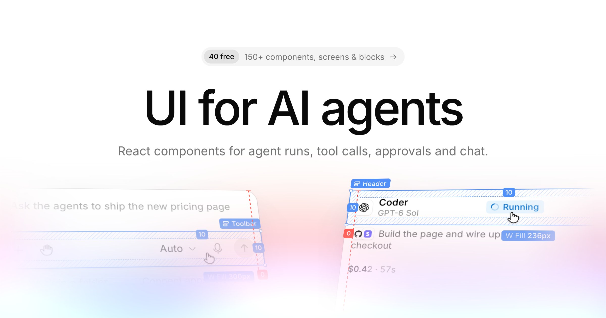

# affectUI — React UI for AI agents & SaaS

> **URL:** https://www.affectui.com/components · **Author:** Flo Höller (@flohoeller, @affectui) · **Captured:** 2026-11-11 · **OG screenshot:** 

## TL;DR
**178 items** — **91 components**, **39 screens**, **14 blocks**, **26 illustrations**, **8 motion effects** — focused on the *product side* of AI apps: agent runs, traces, approvals, inboxes, costs, chat, plus classic SaaS inputs. **46 items are free (MIT)**; the rest are a one-time **Pro** license (\$249 individual / \$699 team, lifetime updates, client work allowed). Strongest public reference for **agent-observability UI patterns** — nobody else (AI Elements, assistant-ui, prompt-kit, CopilotKit) covers agent fleets, ledgers, lanes, rate-limit planning or root-cause trees.

## Architecture & distribution
- **Single-file components:** every item is one `.tsx` with its styles embedded; **needs only React** — no Tailwind config, no Radix, no Framer Motion dependency. Theme via **CSS variables** (dark mode included).
- **Install:** `npx shadcn@latest add https://www.affectui.com/r/<slug>.json` → imports from `@/components/ui/<slug>`; or copy the file.
- **AI-ready:** MCP server, `llms.txt`, prompts; a free **agent skill** (which item fits where, wiring, theming, worked examples, review checklist) + Pro skills (whole screens, migrations, branding, audits, worst-case tests, keyboard focus, responsive layouts).
- **Docs pattern worth copying:** each component page has **"When to use" / "When not to use (→ use X instead)"**, typed usage example, a props table, keyboard map, and a11y notes (keyboard support, focus handling, reduced motion).
- **Compare page:** positions itself vs shadcn/ui (primitives), AI Elements / assistant-ui / prompt-kit (chat), CopilotKit (agent backend), Aceternity / Magic UI (landing motion), Arc UI / BoardUI / Untitled UI (broad product UI), 21st.dev (community browsing).

## Design language (observed)
- **Calm density:** "one calm row per agent", quiet pills ("3 running · 2 need you"), status rings, hairline dividers, monochrome with one accent (blue = current path, amber = needs you, red hatch = overflow/over-limit).
- **Motion as state, not decoration:** counts roll digit-by-digit, rows *glide* to their new sort position, promise toasts morph spinner→check, thumbs stretch on press, items "stamp" out of a review queue, shimmer labels roll through phases ("Thinking…" → check).
- **Human-in-the-loop affordances everywhere:** Approve / Reject / Retry / Undo on single keys, rewind/branch (git-for-agents), "what would also be undone" previews, risk-sorted queues.
- **Plain-language copy:** headings are sentences ("What your agent costs", "What your agent may do without asking").

## What to borrow
1. **Agent run vocabulary** for any AI dashboard: Checkpoints (branching rewind), Lanes (timeline per agent), Trace Waterfall (time + tokens + cost per step), Ledger (undoable changes w/ dependency preview), Tool Call Card (one-line, fold open), Running Now pill, Review Center (risk-sorted single-key review).
2. **"When not to use → use X"** in our own component docs and skills (great for agent routing, mirrors `pick-ui-library`).
3. **Single-file, React-only** packaging = compatible with the `clean-up` skill's "pure React file" output and with Golden Template `src/components/`.
4. **Rolling numbers + gliding reorder** as the two default motions for live data (pair with `@number-flow/react` and Motion `layout`).
5. **Illustrations as product marketing** (Inspect Composer: a component shown "like a selection in a design tool" with spacing numbers and redlines) — great hero idea for design-tool or dev-tool landers.

## Related kit pieces
- Libraries: [../../libraries/ui-primitives.md](../../libraries/ui-primitives.md) (AI Elements, prompt-kit, assistant-ui, affectUI rows)
- Skills: `break-ui` (worst-case data — affectUI ships the same idea as a Pro skill), `stageshow` (faux product UI), `interaction`, `feel`
- MCP: `21st`, `shadcn` (add affectUI registry URL)

---

## Components (91)

### Agents (44)

| # | Component | Tier | What it does | When to use (from docs) |
| ---: | :--- | :--- | :--- | :--- |
| 1 | [Agent Checkpoints](https://www.affectui.com/components/agent-checkpoints) | Pro | An agent's run as a line of checkpoints, like git for agents – rewind to any of them and a new attempt branches out of it, while the one it left fades back but stays | Long agent runs where a wrong turn shouldn't cost the whole run – rewind to the last good checkpoint and let it try again Showing that nothing is lost: an attempt you rewound from stays visible, faded, and you can go bac |
| 2 | [Agent Cursors](https://www.affectui.com/components/agent-cursors) | Pro | Agents working in a document like teammates in a multiplayer editor – live pointers with names, suggestions typed letter by letter, images they resize, code they fix and comments beside the page | Agents that write or edit a document, a brief or a spec while you watch – text, images, code and comments – and you want to see who is where Several agents on one text at once: each change stays a suggestion in its agent |
| 3 | [Agent Findings](https://www.affectui.com/components/agent-findings) | Pro | A swarm of agents checking something – one calm row per agent with its progress, and their findings sliding into a short feed as they're found | Several agents check, audit or verify something in parallel and people want to follow along without drowning in detail Security reviews, code audits, test runs, data checks – anything that turns up findings as it goes |
| 4 | [Agent Fleet](https://www.affectui.com/components/agent-fleet) | Pro | Several agents side by side – each card sums up its sub-agents, and a click opens its tree to the right while the last one folds back into its card | Several agents working at the same time – a launch, the support queue, a release – each with sub-agents of its own Seeing at a glance which agent needs you, which one failed and what the whole fleet costs – without every |
| 5 | [Agent Graph](https://www.affectui.com/components/agent-graph) | Pro | Agents and the tools they call as a living network – a pulse along the link for every call and its answer, busy links growing thicker, agents that breathe while they work and turn amber when they need you | A live overview of a multi-agent system: which agents run, which tools and data sources they call, and how busy each link is Spotting at a glance who waits for you, which call failed and where the traffic (and the cost)  |
| 6 | [Agent Handoff](https://www.affectui.com/components/agent-handoff) | Pro | A task passed from agent to agent like a relay – at every handoff what went along to the next one, and what got lost on the way | Several agents work on tasks one after another – research, analysis, writing, review – and people need to see what each one passed on Debugging multi-agent pipelines: where did the context get lost? Letting people push a |
| 7 | [Agent Inbox](https://www.affectui.com/components/agent-inbox) | Pro | All your background agent tasks in one calm list – live clocks and status tags, filter tabs with rolling counts, rows that unfold to the last steps with Approve, Reject, Retry or Open, and glide to their new place | Agent products where several tasks run in the background and people come back to see what finished, what failed and what waits for them A home screen or dashboard that collects approvals from many runs in one calm board, |
| 8 | [Agent Lanes](https://www.affectui.com/components/agent-lanes) | Pro | Where every agent is right now – a live timeline with a lane per agent, tasks growing into “now”, hand-offs drawn between agents and approvals right on the block | A team of agents works in parallel and people want to see at a glance who is doing what, and since when Multi-agent pipelines where work moves from one agent to the next (research → writing → review) A control room for a |
| 9 | [Agent Ledger](https://www.affectui.com/components/agent-ledger) | Pro | Everything an agent changed in your systems, each change with an undo – before and after per row, and pointing at Undo shows what builds on it: what would be undone too, and what can't be taken back | An agent works in real systems – code, payments, CRM, docs, chat – and people need to see what it changed and take it back An audit trail next to a run, with before and after for every change Anywhere undo needs to be ho |
| 10 | [Agent Monitor](https://www.affectui.com/components/agent-monitor) | Pro | One agent at work, as a card – its current step with a clock and the bill so far, a time strip and the finished steps with the logo of each tool, a click on any of them for the details; the exact command when it needs your OK; folds into a small bar with the tools it has used | A dashboard tile or side panel that keeps one agent in view while people do other work – its current step, the clock and the bill so far Agents that must ask before they touch something real – a deploy, a release, a refu |
| 11 | [Agent Plan](https://www.affectui.com/components/agent-plan) | Pro | An agent's step-by-step plan to review before it runs – rename, drag to reorder, remove or add steps, then watch each one run with live timers and retry from a failed step | An agent is about to do several things in a row and people should agree to the plan first Long or expensive runs (tool calls, emails, writes) where a wrong order or an extra step costs real time Showing the same plan as  |
| 12 | [Agent Queue](https://www.affectui.com/components/agent-queue) | Pro | The work waiting for your agents, and how fast it moves – jobs drop into a live queue, glide into free worker slots as growing bars and land in Done or Failed, while a depth chart shows the backlog build up when a rate limit pauses the workers and drain when they resume | A job queue in an agent product – how many tasks wait, which worker runs what, and how fast the backlog moves Watching backpressure live: a provider rate-limits, the workers pause, the queue builds up and drains again An |
| 13 | [Agent Recap](https://www.affectui.com/components/agent-recap) | Pro | What the agents did while you were away – the night as a small chart with a peak per event, then a board of what needs you, what failed and what's done, acted on right on the card | The first thing people see when they come back to agents that kept working – in the morning, after a meeting, after a weekend A catch-up where the few things that need a decision come first and can be decided right there |
| 14 | [Agent Steering](https://www.affectui.com/components/agent-steering) | Pro | Steer an agent while it works – queue a note for the next step and watch it glide into the plan when the agent picks it up, or interrupt right away | An agent runs for a while and people notice something it should do differently – without stopping it Long runs where a correction is cheaper at the next step than a restart from scratch Showing which instruction changed  |
| 15 | [Agent Trail](https://www.affectui.com/components/agent-trail) | Pro | The steps an agent works through, as one quiet trail – a header with the task and "3/5", done ones with a check and their time, the one it is on says what it is doing and branches into its sub-steps with a live timer, a step that needs approval waits with a dashed ring; a short fading light runs down the trail into the sub-step it is on | Showing where an agent is in a task while it runs – what's done, what it is doing right now and what comes next A chat answer, a side panel or a task card that should show the agent's steps without a full trace Plans wit |
| 16 | [Agent Tree](https://www.affectui.com/components/agent-tree) | Pro | Who started whom – an orchestrator and its sub-agents as a live tree, with status, cost and time on every card, costs rolling up each branch, and branches that fold to one line | Multi-agent runs where an orchestrator hands parts of a job to sub-agents – and those start their own Seeing at a glance which branch is still running, which one waits for you and which one is expensive A run overview ne |
| 17 | [Approval Card](https://www.affectui.com/components/approval-card) | Pro | An agent asks before it acts – risk badge, preview, Approve and Deny with shortcuts, a pausing countdown, and a smooth morph into a resolved row | An agent is about to do something hard to undo – send email, delete files, spend money, deploy – and a person should say yes first Human-in-the-loop tool calls in a chat or an agent run log, one card per pending call Req |
| 18 | [Approval Gates](https://www.affectui.com/components/approval-gates) | Pro | The approval requests of an agent run as a stack of cards – the one to decide now on top with who asks, what exactly and why, the diff or arguments on it; approve, reject or change it first, and it drops into the decided list while the next rises – open ones hold the steps behind them | Human-in-the-loop for agent runs: every tool call, file change, sub-agent or message that needs a person before it goes out A run that pauses on approvals – who asks, what exactly and why, with the diff or the arguments  |
| 19 | [Autonomy Dial](https://www.affectui.com/components/autonomy-dial) | Pro | How much an agent may do on its own – a three-stop dial, and its real actions gliding between “Runs on its own” and “Asks you first”, with a lock for what always asks | Settings of an agent product: how much the agent may do without asking Onboarding of a new agent, where people decide how much to trust it before the first run Anywhere a permission level is abstract – the list shows wha |
| 20 | [Away Summary](https://www.affectui.com/components/away-summary) | Pro | The “While you were away” card for a chat thread – right where you left off: how long you were gone, what needs you, what failed and what's done as a short list with one action per row; Got it folds it into a one-line divider | Coming back to a chat with an agent that kept working – the card sits in the thread right where you left off A short catch-up: what needs you first, then what failed, then what's done, each with one action A thread that  |
| 21 | [Collaboration Stream](https://www.affectui.com/components/collaboration-stream) | Pro | What agents actually say to each other – a quiet chat where every message shows who it is from and who it is for, handoffs and questions for you tagged, files as chips that open a preview, a card with details under every message, and a composer to name agents with @ or answer a question | Showing what the agents of a run say to each other – not just who started whom, but the actual messages, handoffs and questions Multi-agent runs where you step in: a question for you is tagged, and you answer it or name  |
| 22 | [Conflict Radar](https://www.affectui.com/components/conflict-radar) | Pro | Agents working on their own branches at once, and where they get in each other's way – a row per file and a column per agent, a line between the agents that changed the same lines, each agent's way in one sentence to pick from, and Merge once all are settled | Several coding agents work on their own branches of the same repo at once, and people need to see where they overlap before anything is merged Agents came up with different ways to solve the same thing and someone has to |
| 23 | [Context Map](https://www.affectui.com/components/context-map) | Pro | What fills an agent's context window, as a living treemap – system prompt, tools, memory, every file, the chat and tool results as tiles that glide as it grows, the free space dashed, and compaction squeezing old turns into a summary | Showing what fills an agent's context window – and why it's running out Debugging long sessions: which files, turns or tool results take the room Making compaction visible – old turns squeezing into a summary |
| 24 | [Context Window](https://www.affectui.com/components/context-window) | Pro | What fills the model's context, as a field of cells – hover a part to light it up, remove files, and compact the conversation while its cells shimmer and clear | Chat and agent products where people should see what the model currently has in mind – and why answers get slow, expensive or forgetful Next to a composer or in a session panel, to clean up before the window is full: dro |
| 25 | [Cost Waterfall](https://www.affectui.com/components/cost-waterfall) | Pro | Where the money and tokens of an agent run go – every LLM call, tool call and sub-agent as a step in a waterfall, with model, tokens, cost and time, the most expensive step on top and a switch between cost and tokens | Showing what an agent run cost, and which steps spent it – next to a chat, in a run log or on a billing page Finding the expensive step: the bars step across to the total, so the long ones are where the money went Live r |
| 26 | [Decision Card](https://www.affectui.com/components/decision-card) | Pro | An agent's question, asked the way Claude asks one – its own card just above the chat composer: numbered options with one Recommended, Approve / Decline for an approval, preview tiles for a pick, and a last row for your own words; a click or 1–5 answers, Later folds it to one line | An agent in a chat needs one answer from you before it goes on – which option, approve or not, which variant Several tasks wait on you at once: one card with a pager, right where you type You want answers by keyboard – 1 |
| 27 | [Decision Tree](https://www.affectui.com/components/decision-tree) | Pro | An agent stuck on a decision lays out its options as a tree – the consequences of each branch, the risky ones marked, its own pick highlighted – and you choose a path or write your own | An agent hits a fork it shouldn't take alone – it asks how to proceed and shows what each way would change Backend calls without much to look at: data cleanups, refunds, rollouts, escalations – the consequences are the c |
| 28 | [Delegate Board](https://www.affectui.com/components/delegate-board) | Pro | Hand work to your agents by dragging it onto them – each agent previews its new “busy until” time, or switch to Auto and every new task goes to whoever is free first | People hand tasks to a team of agents and want to see who is free and how long each one is busy Re-balancing work between agents: move a queued task to someone with more room Showing an automatic routing suggestion befor |
| 29 | [Fallback Chain](https://www.affectui.com/components/fallback-chain) | Pro | One request finding a model that answers, as a small flow diagram – the request branches out to each model in its fallback order, a light runs to the one being tried, failed branches break red, and the one that answers runs on to the response | A request can go to several models, providers or regions and people should see which one answered – and why the others didn't Model routers, LLM gateways, retries across providers, uptime and incident views |
| 30 | [Fan-out Grid](https://www.affectui.com/components/fan-out-grid) | Pro | One agent hands a big job to many workers – every task a cell on a live grid that fills in as they get through it, with retries, failures, cost and the time left, and the details of any task on hover | An agent fans one job out to many workers – enriching leads, translating pages, labelling tickets, running evals – and you want to watch it fill in Batch runs with hundreds of tasks, where retries and failures matter mor |
| 31 | [Inline Diff](https://www.affectui.com/components/inline-diff) | Pro | AI edits to prose shown inline – struck and added words you accept or reject one by one, with keys, a popover and undo | An AI rewrote a piece of prose – an email, a paragraph, a product description – and people should approve each edit "Make it shorter", "fix the tone", "fix grammar" actions where most edits are small and scattered throug |
| 32 | [Judge Bracket](https://www.affectui.com/components/judge-bracket) | Pro | How an LLM judge picks the best of several attempts, as a tournament – two answers at a time, the one it prefers moves on, the other fades back; the winner's way through the bracket lights up, and every match opens both answers side by side with the scores and why | LLM-as-a-judge: several models, prompts or temperatures answer the same task and a judge picks the best, two at a time Showing why a generated answer won – every match with both answers side by side, the scores and the j |
| 33 | [Memory Panel](https://www.affectui.com/components/memory-panel) | Pro | What the assistant remembers about you, grouped and editable – a master switch, category filters, and on every memory edit in place, pause or forget with Undo on the tray | Assistants and agents that remember things across chats – the place where people see, correct and remove what was kept Settings or a side panel next to the chat, so a wrong memory can be fixed the moment it shows up in a |
| 34 | [Parallel Attempts](https://www.affectui.com/components/parallel-attempts) | Pro | An agent tries the same task several ways at once and the best one wins – every attempt races as a row with its model, approach and live bar, then gets a score; the best is marked and picked, and you can switch to another | An agent tries a task several ways at once – different models, prompts or approaches – and the best result wins Best-of-N runs, where you want to see them race, compare their scores and keep the say in which one is used  |
| 35 | [Permission Request](https://www.affectui.com/components/permission-request) | Pro | An agent asks for one specific right – who, why and exactly what will happen – and you allow it once, for an hour or always; then it folds into one line with the time left and Revoke | An agent hits an action it isn't allowed to do yet and asks for that one right – push to main, send emails, spend money Granting access for a while instead of forever: just once, for an hour, or always Anywhere people sh |
| 36 | [Plan vs Actual](https://www.affectui.com/components/plan-vs-actual) | Pro | An agent's plan against what really happens – every step's bar grows over its dashed planned ghost, overruns turn amber, the steps after it slide right, and the expected finish moves away from the planned one | Showing whether an agent's run keeps to its plan – and if not, which step made it late Plans with steps that wait for each other, where one overrun pushes everything after it Giving people an honest expected finish time  |
| 37 | [Rate Limit Planner](https://www.affectui.com/components/rate-limit-planner) | Pro | Plan when your agents run so they stay under the API's rate limit – the day's load as a line chart, one row per agent run to drag; Spread out lowers the peak, the overflow is hatched in red | Scheduling agent runs, cron jobs or batch work against one API rate limit (tokens per minute) Showing why a run hit 429s – which runs overlap and when the day goes over An ops or settings page where people move their own |
| 38 | [Review Center](https://www.affectui.com/components/review-center) | Pro | A focused workspace for what your agents want to do – the queue sorted by risk, one item at a time with the shaky spans marked, Approve, Edit, Reject and Skip on single keys, a stamp as each one leaves and the next one rising in | Human in the loop at volume: a person signs off what agents produced – code changes, migrations, plans, contract edits, refunds, payments – one item after another Code review for agents: a multi-file change as file rows  |
| 39 | [Root Cause Tree](https://www.affectui.com/components/root-cause-tree) | Pro | How an agent finds out why a run failed, as a fault tree – it checks one hypothesis after another, rules some out, confirms the cause, and the way up to the failure lights up | Showing how an agent debugs a failed run – every hypothesis it has, which it ruled out and which turned out to be the cause Postmortems for agent runs: the failure on top, the way down to what really broke, with the proo |
| 40 | [Running Now](https://www.affectui.com/components/running-now) | Pro | A live status of background agent tasks for a header or sidebar – one quiet pill, "3 running · 2 need you"; open it for the tasks with a filling ring, the step each is on and its steps, Pause and Resume, and Open on the ones that wait for you | An app header or sidebar that should always say what the agents are doing in the background – and whether any of it waits for you Pausing, resuming or opening a task from anywhere, without going to a full task list |
| 41 | [Scheduled Runs](https://www.affectui.com/components/scheduled-runs) | Pro | Agent tasks sorted into a week of sessions – each session has a usage limit, small tasks fill the gaps, big ones are split across sessions, and the stack flies in one card at a time | Agents that run against a usage limit per session – coding agents, API quotas, rate-limited tools – and a week of work to fit in Showing people where their queued tasks will run before they run, and which ones need more  |
| 42 | [Tool Access Map](https://www.affectui.com/components/tool-access-map) | Pro | An agent in the middle with every tool it can reach around it – which ones it used, which failed and which it calls right now; open a tool for its calls and replay one on its own | Seeing at a glance which tools of the run an agent can reach, which it actually used – and which one it calls right now Debugging a tool call: read its input and output, then replay it on its own, with the same input or  |
| 43 | [Tool Call Card](https://www.affectui.com/components/tool-call-card) | **Free** | An agent's tool call in one line – live timer, status and summary, folds open to highlighted arguments and result with copy, retry on errors and a group that sums them up | Tool and function calls in an agent chat or run log – what was called, with what, and what came back Agents that call several tools per turn – wrap them in ToolCallGroup so the answer isn't buried under cards Developer-f |
| 44 | [Trace Waterfall](https://www.affectui.com/components/trace-waterfall) | Pro | Where the time and money of an agent run go – every LLM call, tool call and sub-agent as a bar on a live timeline, with tokens and cost per step, the slowest call marked and branches that fold into their parent | Debugging an agent run: how long each step took, where the time and the money went, which call is slow A run view next to a chat or a log – every LLM call, tool call and sub-agent as a bar on one timeline Live runs, wher |

### Chat (10)

| # | Component | Tier | What it does | When to use (from docs) |
| ---: | :--- | :--- | :--- | :--- |
| 45 | [AI Answer](https://www.affectui.com/components/ai-answer) | Pro | Streamed answer with source cards, citation chips that preview their source, copy, regenerate, feedback and follow-ups | Answers from an assistant that searched your docs, the web or connected tools and should show where each claim comes from Research, support or knowledge-base products where people need to check the source before they act |
| 46 | [Chat Composer](https://www.affectui.com/components/chat-composer) | Pro | Prompt composer with model picker, voice input, app connections and approval request | The main input of an AI assistant or agent that can act on connected tools Flows where the user has to grant extra permissions before a run |
| 47 | [Cited Answer](https://www.affectui.com/components/cited-answer) | Pro | An AI answer wired to its sources – point at a citation to light up its sentence and source, click to unfold the quoted passage with the matching words marked | Search, research and support answers where people need to check which sentence comes from which source before they trust it A finished answer from your RAG pipeline that already knows the passage behind each claim – the  |
| 48 | [Comment Thread](https://www.affectui.com/components/comment-thread) | **Free** | One comment with replies – an assistant reports what it did, folds open details and answers @mentions | A single conversation attached to a selection, a cell or a line of text Showing what an assistant did after someone asked for a change |
| 49 | [Comments Panel](https://www.affectui.com/components/comments-panel) | Pro | Comment feed with filters, runnable /edit commands, resolve and a composer | A comments sidebar next to a document, design or record Collaboration with an assistant that can apply edits people suggest with /edit |
| 50 | [Message Actions](https://www.affectui.com/components/message-actions) | **Free** | The quiet bar under an AI message – copy turns into a check, regenerate spins and unfolds a version switcher, thumbs pop and ask why, read aloud becomes a tiny equalizer | Under every assistant message in a chat – copy, try again, rate and listen without leaving the conversation Wherever a model can answer more than once and people should be able to flip between the answers When you collec |
| 51 | [Model Picker](https://www.affectui.com/components/model-picker) | Pro | The model menu of an AI chat – point at a model and its speed, quality and cost bars fill, switch on extended thinking and its effort unfolds, while the tray rolls the first-token time and price | The model switch in the toolbar of a chat composer – the place people decide between fast, cheap and smart Products with a few models that differ in speed, quality and price, and settings that ride along with the model:  |
| 52 | [Thinking Loader](https://www.affectui.com/components/thinking-loader) | **Free** | A small working pill for AI replies – an eight-ray spinner and a shimmering label that rolls through phases and settles on a check | The wait between sending a prompt and the first streamed token – one line that says what the model is doing Agent and pipeline steps with real labels: searching, reading, running a tool, writing Inline in a chat bubble o |
| 53 | [Thinking State](https://www.affectui.com/components/thinking-state) | Pro | AI working panel with a live timer, searched sources and thinking steps that appear one by one | Showing what an AI assistant is doing while it works: searching, reading, drafting Long-running tasks where a visible trail of steps builds trust and keeps people waiting patiently |
| 54 | [Writing Assistant](https://www.affectui.com/components/writing-assistant) | Pro | AI chat card with a soft gradient glow, suggestions, streaming replies and live voice dictation | A small AI helper inside an editor, CRM or sidebar – rewrite, shorten, translate or draft Landing pages that should show an assistant you can actually try, including voice input |

### Inputs (15)

| # | Component | Tier | What it does | When to use (from docs) |
| ---: | :--- | :--- | :--- | :--- |
| 55 | [Billing Schedule](https://www.affectui.com/components/billing-schedule) | Pro | Build a billing phase – start date, duration, products with repeats and timing, discount, minimum and live totals | Quoting and contract tools where a phase of billing is put together – set-up fees, licences, support Admin screens for subscriptions with one-off and recurring charges, discounts and minimum commitments |
| 56 | [Checkbox](https://www.affectui.com/components/checkbox) | **Free** | A real checkbox with a label and a second line, a some-of-them state for Select all, an error and a card row – the check draws itself | Yes or no choices that are saved with a form: agreeing to terms, picking several items of a list, opting in Select all over a list – the some-of-them state shows a dash while only part of it is picked |
| 57 | [Combobox](https://www.affectui.com/components/combobox) | Pro | Pick one or many from a searchable, grouped list – chips with avatars, highlighted matches, create-on-the-fly and full keyboard support | Assigning people, labels, tags or projects – anything picked from a list that's too long to scan Filters where several values can apply at once, like owners or statuses Tag fields that should also accept new values (crea |
| 58 | [Date Range Picker](https://www.affectui.com/components/date-range-picker) | Pro | Presets and two calendars with a hover preview, comparison with the previous period or year, full keyboard control | Analytics, reports and dashboards where people switch between periods and compare them Filters for bookings, invoices or logs that need a start and an end date |
| 59 | [Dropzone](https://www.affectui.com/components/dropzone) | Pro | Drag files in and watch them upload – fanning documents, colored type badges, progress with time left, errors with retry | Uploading documents, images or media – attachments, imports, asset libraries, onboarding Several files at once, where people want to see what's done, what's still running and what failed |
| 60 | [Filter Menu](https://www.affectui.com/components/filter-menu) | **Free** | Grouped filters with removable chips, collapsible checkbox groups, Clear all and full keyboard control | Filtering a list, table or board by a few groups of options – stage, owner, region and the like Side panels or popovers where people pick several filters and want to see them all at a glance |
| 61 | [Integration Settings](https://www.affectui.com/components/integration-settings) | Pro | Settings card for a connected service – on/off switch, API key, validated site address, time zone and a save bar | The settings of one connected service – a store, an ad account, a data source Forms that should only save when someone confirms, with a clear way to discard |
| 62 | [OTP Input](https://www.affectui.com/components/otp-input) | **Free** | The verification code field done right – a gliding focus ring, paste and SMS autofill, a calm shake on errors and a morph into Verified | Two-step sign-in, email or phone verification, confirming a sensitive action with a one-time code Any short code people copy from an email or SMS – paste and autofill fill every box at once |
| 63 | [Prompt Library](https://www.affectui.com/components/prompt-library) | Pro | Saved prompt templates with variables – type straight into the sentence, watch the finished prompt assemble below, and use it once every variable is filled | AI products where people reuse the same prompts with small changes – summaries, release notes, outreach, debugging Next to a chat composer, as the place to pick a saved prompt, fill in the blanks and send it Team prompt  |
| 64 | [Select](https://www.affectui.com/components/select) | **Free** | Pick one option in the Text Field's look – icons and a second line per option, a gliding highlight, type-ahead and a list that never gets cut off | Picking one option from a short or medium list in a form: a role, a model, a time zone, a plan Settings rows next to Text Fields – same height, edge and focus, so the form reads as one |
| 65 | [Stepper Form](https://www.affectui.com/components/stepper-form) | Pro | A multi-step flow for onboarding and setup – steps that fill and check off, sliding steps, a card that morphs to each step, inline validation and a success state | Onboarding, checkout or setup wizards where one long form would feel like too much at once Flows whose later steps depend on earlier answers, ending in a review before anything is created |
| 66 | [Switch](https://www.affectui.com/components/switch) | **Free** | On or off for things that apply right away – label and second line, at the start or across a settings row, a thumb that stretches as you press it | Settings that apply the moment you flip them: notifications, features, a mode Settings rows with the label on the left and the switch on the right – placement="end" |
| 67 | [Tag Input](https://www.affectui.com/components/tag-input) | **Free** | Several values in one field as chips – paste a whole list, a check per value, duplicates flash, Backspace and arrow keys to edit | Several short values in one field: email addresses to invite, labels, keywords, domains, stop words Lists people paste from elsewhere – commas, spaces or new lines turn into chips at once |
| 68 | [Text Area](https://www.affectui.com/components/text-area) | **Free** | The multi-line twin of the Text Field – grows with the text, a character count, a button for more room and ⌘ Enter to send | Anything longer than a line in a form: descriptions, notes, bios, feedback, instructions or context for an assistant Settings and creation dialogs next to Text Fields – same label, hint, error and focus, so a form reads  |
| 69 | [Text Field](https://www.affectui.com/components/text-field) | **Free** | One input for every form – label, hint and error in place, prefix and suffix, clear, show-password and copy buttons, a character count | Every single-line field in a form: names, emails, URLs, amounts, search, passwords, API keys Settings pages, sign-up and onboarding – one field everywhere, so all your screens look and behave the same |

### Data display (7)

| # | Component | Tier | What it does | When to use (from docs) |
| ---: | :--- | :--- | :--- | :--- |
| 70 | [Breakdown Chart](https://www.affectui.com/components/breakdown-chart) | Pro | Stacked bar chart with measure, slice and segment pickers, a hover breakdown and a linked table | Showing how a set of records splits up – tasks by status and priority, tickets by team, orders by region Reports where people want to switch the view themselves without leaving the page |
| 71 | [Change Summary](https://www.affectui.com/components/change-summary) | **Free** | What moved since last time – one metric per row with a colored trend | A short recap at the top of a dashboard or a weekly report Explaining in words what changed, next to the charts that show it |
| 72 | [Compact Breakdown](https://www.affectui.com/components/compact-breakdown) | Pro | A total split into its parts in one small card – numbers roll, the bar glides and the ranked rows trade places when the period changes | One number and what it is made of – revenue by channel, usage by feature, tokens by model, tickets by category Dashboards where the card sits next to others and a full chart would be too much Whenever people switch betwe |
| 73 | [Data Table](https://www.affectui.com/components/data-table) | Pro | Spreadsheet-style table: select cells and ranges, edit in place, copy and paste, undo and sort | Small databases people edit in place – tools, vendors, budgets, contacts Data that moves to and from Excel or Google Sheets with copy and paste Lists where people pick several rows to act on |
| 74 | [Experiment Card](https://www.affectui.com/components/experiment-card) | Pro | An A/B test in two lines that quietly unfolds on hover – variants linked to a tiny chart, a metric switch with rolling numbers, and a winner you pick with a click | A/B tests, prompt or model comparisons, pricing experiments – anything with a few variants measured the same way Lists of running experiments where the result should be one hover away When people should not only read the |
| 75 | [KPI Chart](https://www.affectui.com/components/kpi-chart) | Pro | Metric card with a multi-line chart and a tooltip that follows the pointer | Dashboards that show one headline number and how its parts moved over a short period Comparing a handful of channels, pages or plans day by day |
| 76 | [Usage Meter](https://www.affectui.com/components/usage-meter) | Pro | Plan usage and AI credits – a stacked credits meter by category, daily sparkline, limits and a button that speaks up near the limit | The usage or billing page of a SaaS or AI product – credits, tokens, minutes or messages per billing cycle Showing what the usage went into (chat, search, images, API) next to plan limits like seats and storage Nudging p |

### Feedback (5)

| # | Component | Tier | What it does | When to use (from docs) |
| ---: | :--- | :--- | :--- | :--- |
| 77 | [Decision Inbox](https://www.affectui.com/components/decision-inbox) | **Free** | Open decisions with two quick answers each – answered ones confirm and fold away | Dashboards or agents that need a quick yes / no from a person before they continue Approvals, renewals and alerts that can be answered with one click |
| 78 | [Notification Stack](https://www.affectui.com/components/notification-stack) | **Free** | Notice cards stacked behind each other – dismiss the front one to reveal the next | A few announcements or notices in a corner of an app – releases, maintenance, invites Toast-style messages that stay until someone dismisses them |
| 79 | [Progress Tracker](https://www.affectui.com/components/progress-tracker) | **Free** | Onboarding checklist with an animated progress bar, ticks that draw themselves and auto play | Onboarding checklists that guide new users through their first steps Any short list of tasks where progress should feel rewarding |
| 80 | [Setup Guide](https://www.affectui.com/components/setup-guide) | Pro | Onboarding panel with a progress bar and collapsible task groups that strike through when done | Onboarding with several areas, each made of a few steps that build on each other A floating guide in a dashboard corner that people can fold away and come back to |
| 81 | [Toaster](https://www.affectui.com/components/toaster) | Pro | Calm toasts from anywhere – a stack that fans out on hover, promise toasts that morph from spinner to check, swipe to dismiss | Short confirmations after an action – saved, copied, sent, moved to trash (with Undo) Background work people started and want to hear back from – uploads, syncs, exports (toast.promise) Errors that don't block the page,  |

### Navigation (4)

| # | Component | Tier | What it does | When to use (from docs) |
| ---: | :--- | :--- | :--- | :--- |
| 82 | [Command Menu](https://www.affectui.com/components/command-menu) | Pro | Search and run anything from one field – tool actions with logos and ⌘1–⌘5, everyday commands with icons | A ⌘K menu that runs actions across the tools your product connects to Power users who want to reach any page or action without the mouse |
| 83 | [Integration Picker](https://www.affectui.com/components/integration-picker) | Pro | Integrations page of a command menu – search, a list of services and the picked one with its connection on two tiles | The integrations step of a command menu or settings dialog Letting people find a service quickly and switch it on without leaving what they're doing |
| 84 | [Profile Menu](https://www.affectui.com/components/profile-menu) | **Free** | Account card with the signed-in user, menu actions and profile setup progress | The dropdown behind the avatar in an app header Nudging people to finish their profile, right next to the account actions |
| 85 | [Segmented Control](https://www.affectui.com/components/segmented-control) | **Free** | Switch between two to six options – a raised pill or underline that glides, stretches a little and can be dragged across, with icons, counts and badges | Switching between two to six views of the same content – sections of a dashboard, list / board / calendar, monthly / yearly A choice that applies right away and where every option should stay visible |

### Cards (4)

| # | Component | Tier | What it does | When to use (from docs) |
| ---: | :--- | :--- | :--- | :--- |
| 86 | [Email Draft](https://www.affectui.com/components/email-draft) | **Free** | Agent-written email for review – switch recipient and tone, edit inline, remove the attachment, send or discard with undo | Human-in-the-loop flows where an agent drafts an email and someone approves it – renewals, reminders, follow-ups Inboxes or task lists of pending outreach, one card per record |
| 87 | [Project Card](https://www.affectui.com/components/project-card) | Pro | A two-line project summary that quietly unfolds on hover – a progress ring with one segment per subtask, a people filter and a status picker, all linked by hover | Boards, lists and sidebars where many projects or tasks sit next to each other and the details should be one hover away Anything with a short summary and a longer truth behind it – a project, a ticket, a deal, an agent r |
| 88 | [Smart Recommendation](https://www.affectui.com/components/smart-recommendation) | **Free** | Suggestion card with a confidence signal, alternatives to switch to and accept with undo | Suggesting the next step an app or assistant thinks is best – with a way out Settings people rarely change but should get a nudge on, like sync modes or plans |
| 89 | [Tips Panel](https://www.affectui.com/components/tips-panel) | **Free** | Grid of short tips with one action each – taken tips turn into a done state | Pointing new users to features they haven't tried yet A “What's new” or getting-started panel in a dashboard or a dialog |

### Buttons (2)

| # | Component | Tier | What it does | When to use (from docs) |
| ---: | :--- | :--- | :--- | :--- |
| 90 | [Button](https://www.affectui.com/components/button) | **Free** | Primary, secondary, ghost and destructive buttons with icons, sizes and a shimmering loading state | Any action a user triggers: submit a form, send a message, open a dialog Async actions that take a moment – the loading state keeps the label readable while it works |
| 91 | [Reaction Bar](https://www.affectui.com/components/reaction-bar) | **Free** | Like, comment, repost and share in one pill – icons pop and fill, counts roll in digit by digit | Reactions under posts, comments or updates in a feed Any toggle with a public count, like saves or upvotes |

## Screens (39)

| # | Item | Tier | What it is |
| ---: | :--- | :--- | :--- |
| 1 | [Agent / Activity](https://www.affectui.com/screens/agent-activity) | Pro | What your agent did – every step as a sentence with its app's logo, the task and who let it (on its own or you approved), grouped by day; Undo while it can be taken back draws a line through it, and each step says why it could and what Undo does |
| 2 | [Agent / Inbox](https://www.affectui.com/screens/inbox) | Pro | What your orchestrator needs from you, one question at a time – pick an option, a variant or approve, send it in a keystroke and the next one glides in |
| 3 | [Agent / Memory](https://www.affectui.com/screens/agent-memory) | Pro | What your agent knows about you and your work – grouped by where it applies, each with where it came from and where it was used; a memory it recalls lights up while it works, and what it picks up on its own waits for your OK |
| 4 | [Agent / Orchestration](https://www.affectui.com/screens/agent-orchestration) | Pro | A live multi-agent run as a tree on a canvas – watch work flow to the running agents, follow every call in the trace below and open an agent for its tasks, context and cost |
| 5 | [Agent / Permissions](https://www.affectui.com/screens/agent-permissions) | Pro | What your agent may do without asking – one choice on top (Careful, Balanced, Hands-off) said in plain words, the apps it works in, the red lines that always ask, and each app with its actions grouped Reads, Changes, Needs care |
| 6 | [Agent / Schedules](https://www.affectui.com/screens/agent-schedules) | Pro | What your agent does again and again – the hours around now on one line, each run a mark that fills while it runs; every schedule with its rhythm in words, its next run, how the last ended, what a run costs and a switch to pause it |
| 7 | [Agent / Tasks](https://www.affectui.com/screens/agent-tasks) | Pro | Your work as tasks, not agents – a calm list grouped by project, each row a ring, where it is in words and a small Needs you, and a click opens what happened so far and what it made |
| 8 | [Agent / Thread](https://www.affectui.com/screens/agent-thread) | Pro | One conversation with your orchestrator – it answers in plain text with small task and decision cards, folds its parallel tools into one line, and keeps working through a dropped connection, a slow upload or a long time away |
| 9 | [Agent / Usage](https://www.affectui.com/screens/agent-usage) | Pro | What your agent costs – the month added up day by day against the budget, where it lands at this pace in one plain line, money ticking up as runs finish, where it went by project or model, and what's worth a look |
| 10 | [AI Chat / Agents](https://www.affectui.com/screens/agent-chat) | Pro | Chat with an orchestrating agent, the agents at work, and a brief to fill in beside it |
| 11 | [AI Chat / Double Sidebar](https://www.affectui.com/screens/agent-chat-rail) | Pro | A plain assistant chat with web search in a double sidebar, like Codex and ChatGPT – a column of icons on the page, the chats in a light gray column inside the main area with a project switcher, and what it found in the work area on the right |
| 12 | [AI Chat / Overview](https://www.affectui.com/screens/assistant-overview) | Pro | The AI workspace start page with your numbers under the composer – activity day by day, recent chats, usage, the files it made and this month against the last |
| 13 | [AI Chat / Progress](https://www.affectui.com/screens/agent-chat-progress) | Pro | A plain chat with what the assistant is doing beside it, part of the page – its progress step by step, what it made, and the uploads, apps, web search and skills it used |
| 14 | [AI Chat / Run](https://www.affectui.com/screens/agent-run) | Pro | One autonomous agent run: the plan ticking through its steps, the tool calls, an approval it waits on and the draft it wrote |
| 15 | [AI Chat / Start](https://www.affectui.com/screens/assistant-home) | Pro | AI assistant start page: greeting, prompt box with tools, connected apps and suggestions |
| 16 | [Analytics](https://www.affectui.com/screens/analytics) | Pro | Revenue dashboard: key figures, revenue by channel, breakdown, top products and weekly trends |
| 17 | [App Shell Flat](https://www.affectui.com/screens/app-shell-flat) | Pro | The App Shell laid flat – gray sidebar, an edge-to-edge page and the work area beside it, split by single hairlines |
| 18 | [App Shell Inset](https://www.affectui.com/screens/app-shell) | Pro | Collapsible sidebar with workspace, menu, projects and account, and a resizable work area on the right – tools, browser and suggested sources – the frame every screen sits in |
| 19 | [CRM](https://www.affectui.com/screens/crm) | Pro | Company list with pipelines, open views as tabs and an editable data table |
| 20 | [Evals](https://www.affectui.com/screens/evals) | Pro | Prompt evaluation dashboard: pass rate by version, reviewable prompt changes and test cases you can re-run |
| 21 | [Folders / Detail](https://www.affectui.com/screens/folder) | Pro | Inside one folder: breadcrumbs, file cards with previews, and an empty state |
| 22 | [Folders / Overview](https://www.affectui.com/screens/files) | Pro | Folder overview with tabs, search, sort, grid/list toggle and file templates |
| 23 | [Integrations](https://www.affectui.com/screens/integrations) | Pro | App directory with a sticky header, categories, search and connect states |
| 24 | [Kanban Board](https://www.affectui.com/screens/kanban) | Pro | Issues on a board by priority – drag cards between columns, switch to a list, filter and sort |
| 25 | [Onboarding](https://www.affectui.com/screens/onboarding) | Pro | First-run flow of an AI workspace: workspace setup, tool connections, team invites and a first agent, with a getting-started checklist |
| 26 | [Onboarding / Brand](https://www.affectui.com/screens/onboarding-brand) | Pro | Second step of setting up an AI assistant: the company's name and the short forms customers use as chips, suggested from the website before; the dashboard glides up to the assistant's card, where its name, greeting and tags fill in as you type |
| 27 | [Onboarding / Ready](https://www.affectui.com/screens/onboarding-ready) | Pro | Last step of setting up an AI assistant: a quiet summary of what it learned from, its name, voice and handover, each with Edit; the dashboard glides back to its top and comes alive – numbers land, Draft turns Live |
| 28 | [Onboarding / Tone](https://www.affectui.com/screens/onboarding-tone) | Pro | Third step of setting up an AI assistant: a short left-aligned form for its name, tone, reply length and who takes over when it isn't sure; the dashboard glides down to a test chat that answers under that name, in that tone and length |
| 29 | [Onboarding / Website](https://www.affectui.com/screens/onboarding-website) | Pro | First step of setting up an AI assistant: the website, docs and help center it should learn from as chips on the left; on the right the assistant's dashboard as a large loading state, where each domain lands in its Knowledge table |
| 30 | [Settings / Billing](https://www.affectui.com/screens/settings-subscription) | Pro | Billing in the settings: the plan with the upcoming bill and usage, plans with monthly or yearly pricing and an add-on, billing address and card, invoices and cancel |
| 31 | [Settings / General](https://www.affectui.com/screens/settings-general) | Pro | Workspace settings with a settings sidebar: icon, name and address as rows, a company context for the assistant and a danger zone that asks for the name |
| 32 | [Settings / Models](https://www.affectui.com/screens/settings-models) | Pro | Model settings with a settings sidebar: default chat and image models with an animated Auto explainer, every provider's models grouped by hosting region with a switch and access per model, filter, search, custom endpoints and your own API keys |
| 33 | [Settings / Notifications](https://www.affectui.com/screens/settings-notifications) | Pro | Notification settings with a settings sidebar: a daily digest with its time, a table of notification types each sent by email, mobile, both or only to the inbox, and quiet hours at night |
| 34 | [Settings / Preferences](https://www.affectui.com/screens/settings-preferences) | Pro | Personal preferences with a settings sidebar: default models with Auto and the Model Wheel, language and appearance, chat tools as tiles, custom instructions the model reads with every message and the memories it kept |
| 35 | [Settings / Privacy](https://www.affectui.com/screens/settings-privacy) | Pro | Privacy settings with a settings sidebar: switches for ad measurement, analytics and training on chats, this browser's cookies, product emails, active sessions to sign out, chats shared by link and a danger zone to export or delete every chat |
| 36 | [Settings / Profile](https://www.affectui.com/screens/settings-profile) | Pro | Profile settings with a settings sidebar: picture, name, role and email as rows, time preferences, personal context for the assistant and the password |
| 37 | [Settings / Security](https://www.affectui.com/screens/settings-security) | Pro | Security settings with a settings sidebar: email domains to verify, sign-in rules with SSO and two-step verification, the identity provider details to copy, an IP allowlist and a danger zone that signs everyone out |
| 38 | [Settings / Teams](https://www.affectui.com/screens/settings-members) | Pro | Members and teams in the settings: seats at a glance, search, role filter, export and invite, members with role, plan and usage, bulk changes, and teams |
| 39 | [Workflow Builder](https://www.affectui.com/screens/workflow-builder) | Pro | Nodes on a canvas joined by curves – drag them in from a palette, set each one up, then run the workflow and watch every step light up |

## Blocks (14)

| # | Item | Tier | What it is |
| ---: | :--- | :--- | :--- |
| 1 | [Agent Gallery](https://www.affectui.com/blocks/agent-gallery) | Pro | Slim gradient panels with one open product screen in the middle – pick a panel and it glides open |
| 2 | [App Directory](https://www.affectui.com/blocks/app-directory) | Pro | Browse, search and connect integrations – categories, filters and app cards with a connect flow |
| 3 | [Client Context](https://www.affectui.com/blocks/client-context) | Pro | A client workspace with live numbers and a shared context timeline – switch clients, search, filter and add notes or files |
| 4 | [Invoice & Credit Note](https://www.affectui.com/blocks/invoice-credit) | Pro | An invoice and its credit note stacked like paper – switch between them, pick lines to credit, adjust amounts and issue |
| 5 | [KPI Board](https://www.affectui.com/blocks/kpi-board) | Pro | The top of a dashboard – three trend cards, an overview chart that compares this period with the last, and a focus card; hover shows any day's value and every number rolls when the range changes |
| 6 | [Live Session](https://www.affectui.com/blocks/live-session) | Pro | Work with a team of agents while they work – their conversation in the middle, the team's plan ticking off beside it, and the shared context under it; picking an agent points at its steps |
| 7 | [Logo Marquee](https://www.affectui.com/blocks/logo-marquee) | **Free** | The endless “Trusted by” strip – a seamless loop that eases to a stop on hover, scrubs with inertia and lifts the hovered logo to colour |
| 8 | [Metrics Dashboard](https://www.affectui.com/blocks/metrics-dashboard) | Pro | Sales overview – KPI cards pick the metric, one chart switches between dotted line and bars, with top products and channels |
| 9 | [Mission Control](https://www.affectui.com/blocks/mission-control) | Pro | All agents at a glance – what happened since you looked on top, who runs under whom in the middle, what needs you on the side, and one filter for running, waiting and failed that applies to all three |
| 10 | [Mission Timeline](https://www.affectui.com/blocks/mission-timeline) | Pro | All agents at a glance on one clock – what happened since you looked on top, every agent on its own lane in the middle, what needs you on the side, and one filter for running, waiting and failed that applies to all three |
| 11 | [Pricing Plans](https://www.affectui.com/blocks/pricing-plans) | Pro | Pricing section with a monthly / yearly switch, three plan cards and collapsible details |
| 12 | [Run Inspector](https://www.affectui.com/blocks/run-inspector) | Pro | One agent run on one screen – who started whom as a live tree, every agent's calls as small bars on its card, a click opens a call with its error right under its row, and the run's numbers sit on top |
| 13 | [Task Board](https://www.affectui.com/blocks/task-board) | Pro | Kanban board with drag and drop, quick add, a detail panel, search, label filters and a compact view |
| 14 | [Testimonial Wall](https://www.affectui.com/blocks/testimonial-wall) | **Free** | The landing-page wall of quotes – columns that scroll endlessly in opposite directions, ease to a stop on hover and scrub with inertia |

## Illustrations (26)

| # | Item | Tier | What it is |
| ---: | :--- | :--- | :--- |
| 1 | [Agent Team](https://www.affectui.com/illustrations/agent-team) | **Free** | A prompt types itself and branches out into three agents, each with a role and overlapping tool logos |
| 2 | [Cover Flow](https://www.affectui.com/illustrations/cover-flow) | **Free** | Browse covers in 3D – drag, flick or scrub the row, it springs to the nearest cover; images drift in their frames over a soft reflection |
| 3 | [DACH Region](https://www.affectui.com/illustrations/region-dach) | **Free** | DACH map with fading neighbours and a pastel band along the border, switchable to the US, China, India, Brazil or Japan |
| 4 | [Empty Calendar](https://www.affectui.com/illustrations/empty-calendar) | **Free** | Stack of calendar cards marked empty, fanning out on hover |
| 5 | [Enrichment Orbit](https://www.affectui.com/illustrations/enrichment-orbit) | **Free** | Grok tile inside two rings with comets and data nodes orbiting around it |
| 6 | [Frost Cloud](https://www.affectui.com/illustrations/frost-cloud) | **Free** | A frosted white cloud with eyes cut out of it, on a blue or red-orange sky – it floats, turns to look around, blinks, follows the pointer and bounces with a wink when clicked |
| 7 | [Ghosted Chat](https://www.affectui.com/illustrations/ghosted-chat) | **Free** | Unanswered chat messages marked as read, with a thumbs-down reply on hover |
| 8 | [Glass Folder](https://www.affectui.com/illustrations/glass-folder) | Pro | Glassy blue folder with documents behind a frosted pocket that tips open on hover |
| 9 | [Glow Cloud](https://www.affectui.com/illustrations/glow-cloud) | **Free** | A glowing cloud with eyes in red-orange or blue – it floats, turns to look around, blinks, follows the pointer and bounces with a wink when clicked |
| 10 | [Glow Keyboard](https://www.affectui.com/illustrations/glow-keyboard) | Pro | AI chat input that types itself over a glass keyboard – every key press sends a wave up the gradient floor |
| 11 | [Inspect Agent Card](https://www.affectui.com/illustrations/inspect-agent-card) | Pro | An agent card seen like a selection in a design tool – tilted back, with a blue frame, spacing numbers and a red guide walking through its rows |
| 12 | [Inspect Composer](https://www.affectui.com/illustrations/inspect-composer) | Pro | A chat composer seen like a selection in a design tool – tilted back, with a blue frame, spacing numbers and a red guide walking through its rows |
| 13 | [Integration Beam](https://www.affectui.com/illustrations/integration-beam) | **Free** | Your product between the tools it connects – light pulses flow along curved beams, hover to focus a tool, click to pause it |
| 14 | [Integration Flow](https://www.affectui.com/illustrations/integration-flow) | Pro | Integration pills rotating along a dashed arc, each beaming its data into a central analysis hub |
| 15 | [Integration Grid](https://www.affectui.com/illustrations/integration-grid) | **Free** | Honeycomb-like wall of integration logos around a bright centre tile with your product mark, fading out toward the edges |
| 16 | [Layer Stack](https://www.affectui.com/illustrations/layer-stack) | **Free** | Isometric stack of five layers with a list beside it – the chosen entry lifts its layer out in color |
| 17 | [Lead Sourcing](https://www.affectui.com/illustrations/lead-sourcing) | **Free** | ChatGPT tile linked to Gmail and Grok, with a shine running along the connection |
| 18 | [Logo Cluster](https://www.affectui.com/illustrations/logo-cluster) | **Free** | Your mark on a white disc in the middle – company logos bounce out of it and settle around it |
| 19 | [Model Wheel](https://www.affectui.com/illustrations/model-wheel) | **Free** | AI model names on a turning drum – the rows bend away at the edges and each model lands on a soft gray fill |
| 20 | [Outreach Branches](https://www.affectui.com/illustrations/outreach-branches) | Pro | Lines branching out to Gmail, Slack and Notion with colored pulses flowing down |
| 21 | [Project Flow](https://www.affectui.com/illustrations/project-flow) | Pro | Animated scene of a client task branching into subtasks, notes and assigned roles |
| 22 | [Side Folder](https://www.affectui.com/illustrations/side-folder) | **Free** | Glassy blue folder on its side, documents sliding out to the right as the pocket swings open on hover |
| 23 | [Tab Overload](https://www.affectui.com/illustrations/tab-overload) | **Free** | Overlapping browser windows where the highlight follows the hovered tab |
| 24 | [Team Invite](https://www.affectui.com/illustrations/team-invite) | **Free** | Connected teammates – a cursor drags a new one into the empty slot, the line turns solid and they go online |
| 25 | [Voice Orb](https://www.affectui.com/illustrations/voice-orb) | Pro | The face of a voice assistant – a sphere of dots that breathes, catches sound, collapses into a spinning ring while thinking and ripples when it speaks |
| 26 | [World Map Continental](https://www.affectui.com/illustrations/world-map) | Pro | World map with one highlighted continent and a pastel band along its coastline, switchable between all six |

## Motion effects (8)

| # | Item | Tier | What it is |
| ---: | :--- | :--- | :--- |
| 1 | [Blur Crossfade](https://www.affectui.com/motion/blur-crossfade) | Pro | Swaps content with a soft blur while the box glides smoothly to the size of what comes next |
| 2 | [Gradient Floor](https://www.affectui.com/motion/gradient-floor) | Pro | A blurred colour gradient that glows up from the bottom edge – two layers that drift and morph |
| 3 | [Gradient Text](https://www.affectui.com/motion/gradient-text) | Pro | Letters cut from a liquid, ever-flowing gradient – the color sweeps across the word the first time it's seen |
| 4 | [Grid Background](https://www.affectui.com/motion/grid-background) | **Free** | A fine line grid that drifts slowly behind your content and fades out towards the edges |
| 5 | [Number Ticker](https://www.affectui.com/motion/number-ticker) | **Free** | Odometer-style numbers – every digit rolls to its new value and counts in from zero when it scrolls into view |
| 6 | [Shimmer Loader](https://www.affectui.com/motion/shimmer-loader) | **Free** | Skeleton blocks that share one soft light sweep, plus shimmering text for “Thinking…” states |
| 7 | [Text Reveal](https://www.affectui.com/motion/text-reveal) | **Free** | Text that arrives word by word or letter by letter – each piece rises out of a soft blur as it scrolls into view |
| 8 | [Tilt Card](https://www.affectui.com/motion/tilt-card) | Pro | A card that tilts in 3D towards the pointer, with a soft glare that follows it and a smooth spring back |
