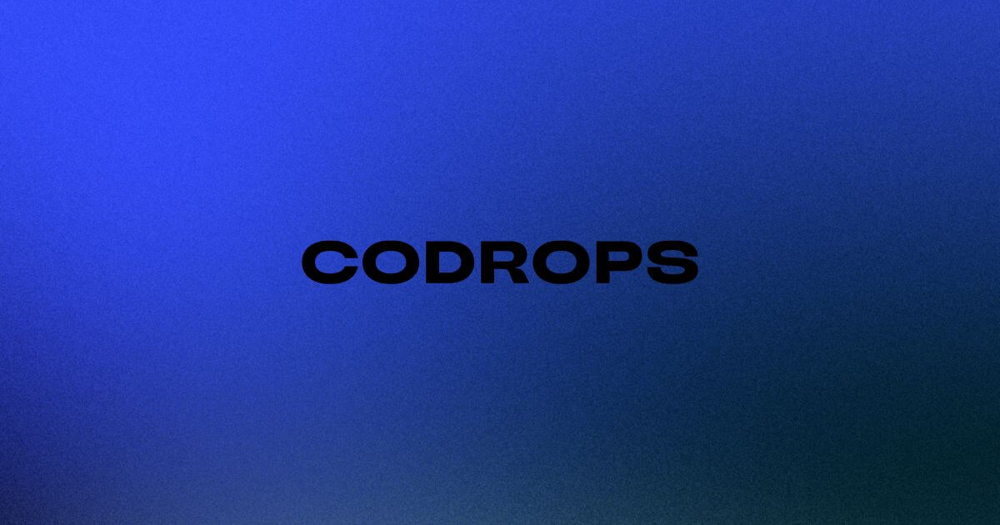

# Codrops (tympanus.net/codrops)

> **URL:** https://tympanus.net/codrops/ · **Type:** Creative-coding tutorials, demos, case studies · **Captured:** 2026-11-11
> 

## What it is
Running since 2009 (Manoela Ilic & Pedro Botelho). The single best source of **production-quality creative front-end techniques** with open-source demos (mostly MIT on GitHub). Sections: All Posts, **Creative Hub** (originals + hand-picked demos), **Webzibition**, Case Studies, Tutorials, Courses (Astro, GSAP), Creative Spotlights, Studio Stories.

## Catalog / structure
| Facet | Details |
| :--- | :--- |
| Recent posts (2026-11) | "Choreographing Kinetic Typography on Scroll with GSAP"; "Inside Au-rel.io: A Portfolio Built Around Grid and Motion"; "Mathias Adolfsson '26: A Curved Carousel, a Barrel Gallery and Motion with a Life of Its Own"; "Old Specimens, New Pixels: Designing the Mineral Collection with Shaders"; "The Making of Brandon Yasin's Portfolio"; "Hervé Was Supposed to Be a Flower Shop"; "The Day After: Stefano De Rosa on Craft, Balance and Designing for AI" |
| Recurring technique families | GSAP ScrollTrigger + SplitText typography; Lenis smooth scroll; OGL / three.js image distortion & hover shaders; WebGPU/TSL particles; curved/barrel carousels; grid-to-fullscreen Flip transitions; page transitions (Barba/Taxi); SVG filter effects; R3F scenes; TypeGPU experiments |

## What to borrow
- Search Codrops before inventing a WebGL/scroll effect — most have a GitHub repo to port.
- Case studies list the full stack (often Astro/Nuxt + GSAP + OGL/three + Lenis) — use as reference architectures for Awwwards-style builds.
- Pair with `3d-research` / `game-research` nightly crawls.

## API / MCP / access
RSS: https://tympanus.net/codrops/feed/ ; demos on github.com/codrops
