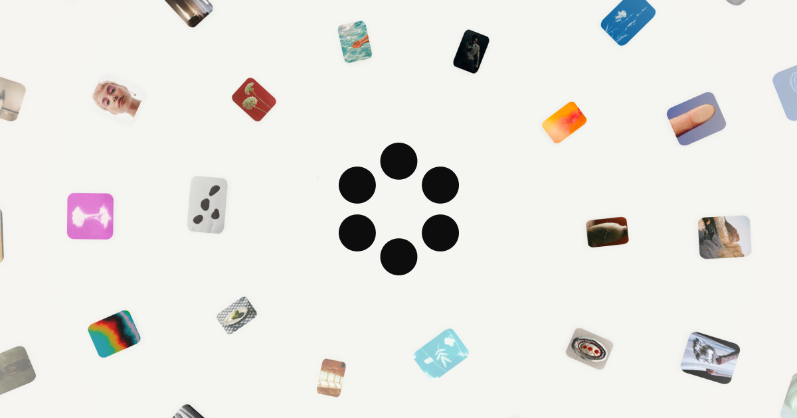

# Cosmos

> **URL:** https://www.cosmos.so · **Type:** Visual moodboarding / inspiration network (Pinterest for creatives) · **Captured:** 2026-11-11
> 

## What it is
Save and organize images/videos into collections; **search by color**, find similar elements from an image, show/blur/hide AI-generated images, collaborate, browser extension, shop. Used by creative teams, studios, students.

## Catalog / structure
| Facet | Details |
| :--- | :--- |
| Features | Collections · color search · visual similarity · AI-image filter · collaboration · extension |

## What to borrow
- Build moodboards for `concept-art` / `style-direction`; color search to validate palettes.

## API / MCP / access
No public API.
