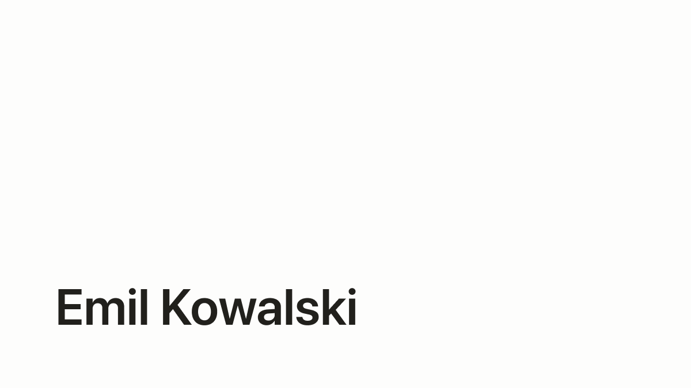
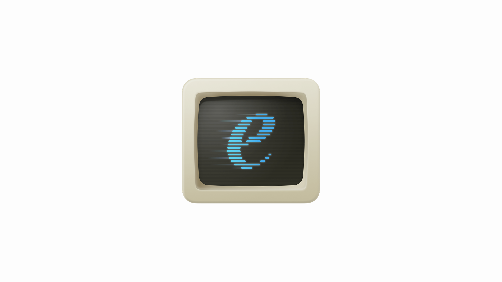
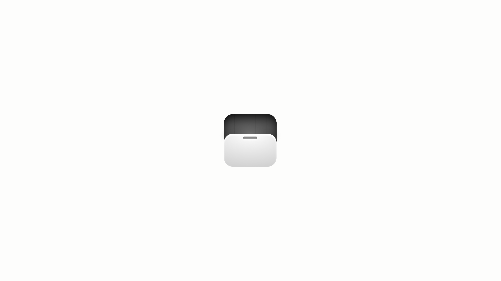

# Emil Kowalski — emilkowal.ski · animations.dev · aiforui.dev · Sonner · Vaul

> **URLs:** https://emilkowal.ski/ · https://animations.dev/ · https://aiforui.dev/ · https://sonner.emilkowal.ski/ · https://vaul.emilkowal.ski/ · GitHub https://github.com/emilkowalski · **Captured:** 2026-11-11
> **Screens:**     

## Who
Design engineer, previously **Linear** and **Vercel** (visual side of product + marketing surfaces). Currently on a break from full-time work, teaching. Author of the two most-copied React interaction components of the decade (**Sonner**, **Vaul**) and the most-recommended web animation course (**animations.dev**). The kit's `motion-craft` plugin (`emil-design-eng`, `animations-dev`, `review-animations`, `improve-animations`, `remove-animations`, `find-animation-opportunities`, `animation-vocabulary`) and `pick-ui-library` / `ask-sonner` skills are derived from his material.

## Projects
| Project | What | Tech / notes | Install |
| :--- | :--- | :--- | :--- |
| **Sonner** | Opinionated toast component for React (~11k★, used by shadcn/ui, Vercel, Cursor…) | Stacked toasts that expand on hover, swipe-to-dismiss, promise toasts, `toast()` callable from anywhere, CSS transitions (interruptible), enter/exit from same edge for spatial consistency | `npm i sonner` |
| **Vaul** | Unstyled drawer component for React (~8k★), built on Radix Dialog | Drag-to-dismiss with velocity, snap points, background scale ("iOS sheet"), scroll-vs-drag disambiguation, Safari theme-color tweening, multi-touch handling, input/keyboard handling | `npm i vaul` |
| **animations.dev** | Interactive web animation course, 45+ lessons on custom platform | 4 modules: (1) theory — easing, springs, timing, purpose, taste (8 lessons, interactive); (2) CSS animations; (3) Framer Motion; (4) good→great — feelings, orchestration, a11y, performance. **4 walkthroughs (15 lessons): Family Drawer, Dynamic Island, Navigation Menu, SVG Animations.** Includes custom easing set + **15 AI skills** | course |
| **aiforui.dev** | "AI for Designers and Engineers" course (4,500+ students) | Turning taste into rules & skills, prototype → shippable workflows, what to delegate vs take over, reviewing AI output; ships **28 daily-use skills** and **Lapse** (animation review tool) | course |
| **ui.land** | Interviews with design engineers (Nanda, SJ Zhang, Sam Selikoff, Brotzky, Paco, Rauno) + resource list | Made by Emil | web |

## Writing (emilkowal.ski/ui) — key ideas
| Article | Sections | Takeaways to encode |
| :--- | :--- | :--- |
| [You Don't Need Animations](https://emilkowal.ski/ui/you-dont-need-animations) | Purposeful animations · Frequency of use · Perception of speed · Building great interfaces | Every animation needs a purpose (explain, spatial consistency, feedback, or rare delight). **Frequency decides**: things used hundreds of times a day (Raycast, command menus, hover on lists) should not animate. **Never animate keyboard-initiated actions.** Delight only for rarely seen moments (feedback morph). |
| [Agents with Taste](https://emilkowal.ski/ui/agents-with-taste) | Transferring taste · Going further | Write a **skill file per interface aspect**; taste = articulable reasons. Example rule: never enter from `scale(0)` — start from a higher scale (≈0.9–0.95) like a deflated balloon that still has shape. |
| [Building a Toast Component](https://emilkowal.ski/ui/building-a-toast-component) | Naming · Animations · Stacking toasts · Swiping · Expanding toasts · Developer experience · The big little details · Why is Sonner successful? | Use CSS **transitions not keyframes** so stacked toasts can be interrupted/retargeted; enter and exit from the same edge; hover expands stack; pause timers when tab hidden; generous swipe threshold w/ velocity; DX: `toast()` from anywhere, no hooks/context. |
| [Developing Taste](https://emilkowal.ski/ui/developing-taste) | Surround yourself with great work · Think about why you like something · Practice | Curate tastemakers; rationalize *why* something feels great; study apps, don't just use them; practice. |
| [The Magic of Clip Path](https://emilkowal.ski/ui/the-magic-of-clip-path) | Basics · Positioning · Comparison sliders · Animating images · Scroll animations · Scroll progress · Tabs transition · Going a step further | `clip-path: inset()` is GPU-friendly and animatable: image reveals, before/after sliders, text fill on scroll, **tabs where a clipped duplicate layer shows the active color** (exclusion tabs pattern), hold-to-delete progress. |
| [7 Practical Animation Tips](https://emilkowal.ski/ui/7-practical-animation-tips) | 1 Scale your buttons · 2 Don't animate from scale(0) · 3 Don't delay subsequent tooltips · 4 Choose the right easing · 5 Make animations origin-aware · 6 Keep animations fast · 7 Use blur when nothing else works | `:active { transform: scale(0.97) }`; start enters at ~0.9+ scale; after the first tooltip opens, subsequent ones open **instantly** (`data-instant` → 0ms); **ease-out for enter/exit** (ease-in feels slower at identical 300ms); set `transform-origin` to the trigger (Radix exposes `--radix-*-transform-origin`); **UI animations < 300ms**; a touch of `filter: blur()` masks imperfect crossfades. |
| [Building a Drawer Component](https://emilkowal.ski/ui/building-a-drawer-component) | Why a drawer? · Anatomy · Drag gesture · Scrolling · Background animation · Motion · Inputs · Multi touch · Snap points · Safari Theme Bar · Debugging · Getting creative | Drag uses `transform` with pointer capture; dismiss on velocity OR distance threshold; 100 ms lockout after scrolling to top before drag can start; background scales down; 500 ms duration + `cubic-bezier(0.32, 0.72, 0, 1)` to mimic the iOS sheet; Safari theme color stepped every 10 ms during open. |

## Signature numbers & rules (cheat sheet)
| Rule | Value |
| :--- | :--- |
| Max duration for UI motion | **< 300 ms** (drawers/sheets can go to ~500 ms) |
| Enter / exit easing | **ease-out** (custom, e.g. `cubic-bezier(0.23, 1, 0.32, 1)` family) — never ease-in for UI |
| On-screen movement | ease-in-out |
| iOS-like sheet | `500ms cubic-bezier(0.32, 0.72, 0, 1)` |
| Press feedback | `scale(0.97)` on `:active` |
| Minimum enter scale | ≈ `0.9`–`0.95` (never `0`) |
| Transform origin | From the trigger, not center |
| Subsequent tooltips | 0 ms delay & 0 ms animation once one is open |
| Frequent / keyboard actions | **No animation** |
| Interruptibility | Prefer CSS transitions / springs over keyframes for anything that can be retriggered |
| Reduced motion | Keep opacity/color, drop movement |

## Visual style of his sites
Minimal, mostly monochrome, generous whitespace, small 14–15px Inter-like text, list-based index ("Projects", "Writing"), interactive demos embedded inline in articles (toggle animation on/off, compare easings side by side) — the article *is* the demo.

## What to borrow
1. Encode his rules as **gates in our evals** (`feel` skill): duration < 300 ms, ease-out enters, no `scale(0)`, origin-aware popovers, no animation on keyboard actions.
2. **Side-by-side "which feels better?" demos** — great format for our design-critique moodboards and skill docs.
3. **Sonner + Vaul** as default toast/drawer in Golden Template builds (see [../../libraries/ui-primitives.md](../../libraries/ui-primitives.md)).
4. **clip-path tabs / reveals** as a cheap, composited alternative to animating width/height.
5. **Taste → skill files**: exactly how this kit is structured; keep adding "why" rationales to skills.

## Related
- [rauno-devouring-details.md](rauno-devouring-details.md), [paco-coursey.md](paco-coursey.md) (exclusion tabs, iOS menu), [interfacecraft-josh-puckett.md](interfacecraft-josh-puckett.md) (DialKit)
- Skills: `emil-design-eng`, `animations-dev`, `review-animations`, `ask-sonner`, `pick-ui-library`
