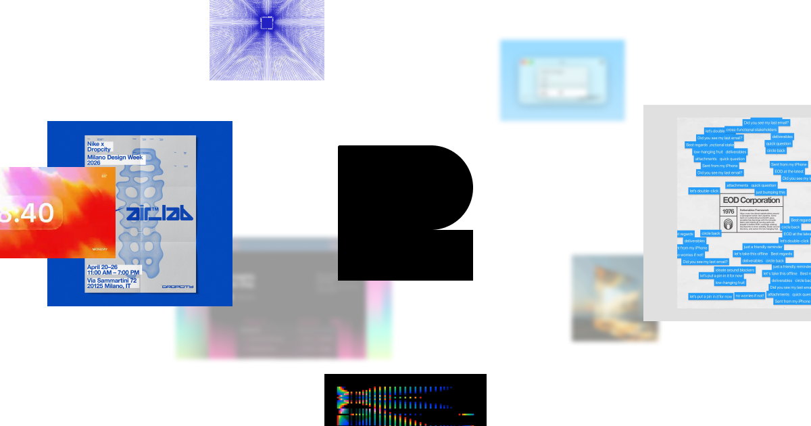

# Godly (godly.website → recent.design)

> **URL:** https://godly.website · **Type:** Curated web/interface/brand inspiration with video previews · **Captured:** 2026-11-11
> 

## What it is
"The best design inspiration on the Internet." Hand-curated feed with **autoplay video previews** of sites (motion visible), now also Launch Videos, Websites, OG Images, App Store Screenshots, App Icons, plus Tools, **Skills**, Jobs. Feed filters: All · Web · Interface · Branding · Motion · Illustration · Posters · Print.

## Catalog / structure
| Facet | Details |
| :--- | :--- |
| Sections | Design feed · Launch Videos (new) · Websites · OG Images · App Screenshots · App Icons · Tools · Skills · Jobs |
| Typical picks | AI workspace login screens, research-lab brand identities, brand worlds (multi-slide), memory-visualization UIs, pitch pages |

## What to borrow
- Best gallery for **motion-forward, high-taste** landing pages — video previews show the interaction, not just a still.
- Use OG Images and App Icons sections for marketing-asset references.
- Use for the 5-benchmark research step of `research` / `jason-design-agent`.

## API / MCP / access
No public API.
