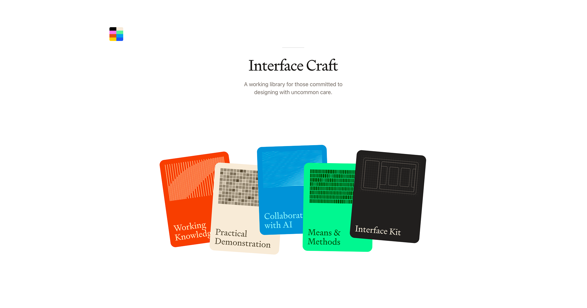

# Interface Craft — Josh Puckett (interfacecraft.dev)

> **URL:** https://interfacecraft.dev · https://joshpuckett.me/dialkit · https://pica.joshpuckett.me · **Captured:** 2026-11-11 · 

## What
"A working library for those committed to designing with uncommon care." Paid library (3 free lessons) of **40+ detailed articles, walkthroughs, interactive videos, skill files, references and custom tools**, organized into thematic collections on a custom platform. Endorsed by Emil Kowalski and Rauno Freiberg.

## Author
**Josh Puckett** — ~20 years designing products (Wealthfront, Dropbox), advisor to early-stage founders, runs Upperstudy (apprenticed hundreds of designers now at Apple, Browserbase, Mercury, Vanta…). Open-source:
- **DialKit** (`npm i dialkit motion`) — live tuning panel (dials, springs, colors, numbers) for React/Solid/Svelte/Vue; hotkeys and scroll gestures. Used on 12 of 30 thisiswhitespace experiments.
- **Pica** — design resource/tool (pica.joshpuckett.me).

## What to borrow
- **DialKit during build → bake values** before ship (our `feel` and `interaction` loops can expose a DialKit panel in dev only).
- The "uncommon care" bar as an explicit critique dimension.

## Related
[thisiswhitespace.md](thisiswhitespace.md) · [emil-kowalski.md](emil-kowalski.md) · [../../libraries/motion.md](../../libraries/motion.md)
