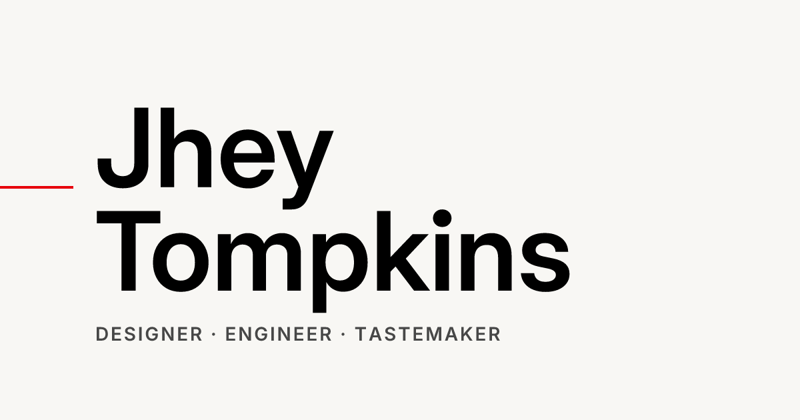

# Jhey Tompkins — jhey.dev

> **URL:** https://jhey.dev · https://jhey.dev/index · CodePen https://codepen.io/jh3y · X @jh3yy · **Captured:** 2026-11-11 · 

## Who
"Designer · Engineer · Tastemaker", **Brand Design Studio @ Shopify**; formerly Google (Chrome DevRel) and Vercel. Known for making cutting-edge CSS approachable — "Wait, how did you do that?"

## Prototype archive
The index lists **~860 prototypes (2016–2026)**: 2016 16 · 2017 8 · 2018 86 · 2019 53 · 2020 106 · 2021 64 · 2022 65 · 2023 109 · 2024 167 · 2025 96 · 2026 90. Recent highlights (2025–2026):

| Theme | Examples |
| :--- | :--- |
| **Liquid glass / refraction** | liquid-glass, liquid-glass-component, liquid-toggle, liquid-slider, liquid-membrane, refractive-gem, aqua-css |
| **Anchor positioning / popovers** | ios-anchor-popover, anchor-hover-cards, radial-color-picker-popover, cyber-popover, scroll-target-anchored-nav, toc-scroll-markers |
| **Scroll-driven CSS** | scroll-driven-logo, pro-scroll-masking, composable-scroll, view-transition-strips, velocity-gallery-scroller, apple-photo-scroller, ios-alarm-scroller, curved-scrollbar, section-color-crossfade |
| **Numbers & dials** | number-dial, number-roll, number-gpu, split-flap, split-flap-countdown, departure-flipper (+WAAPI), counter-cascade, thinking-dial, number-picker-exploration |
| **Buttons & micro-interactions** | fizzy-button, hyperspace-button, rainbow-button, glsl-chaos-button, add-to-cart-whoosh, add-to-cart-physics, hold-to-sign, slide-to-unlock, roll-to-unlock, pop-glow, button-border-pulse, shiny-webcam-button |
| **Cards & borders** | progressive-blur-cards, depth-map-cards, eased-gradient-cards, holo-stickers, tech-trading-card, proximity-electric-border, border-displacement, translucent-border-punchout, saturated-borders, adaptive-radius, border-shape-demo |
| **Text & masks** | pixel-displacement-text, ascii-cursor-reveal, easing-masks-gradients, masked-copy-input, intelligent-text-bloom, circular-text-2025, digital-rain, video-to-ascii-dropper |
| **Canvas / WebGL / physics** | echo-fluid, pixi-noise-displacement, newtons-bulbs, paper-crumple, genie-canvas-v2, web-disco-ball, sand-cube, esp32-particle-sim |
| **Navigation & layout** | dock, x-carousel, barrel-grid, infinite-grid-playground, sidebar-transition, animated-sidebar-pattern, morph-disclosures, apple-disclosures, mind-the-gap-pills, spotlight-tabs, overwatch-menu |
| **Hardware/fun** | esp32-magic-eight, lego-webcam, sling-ring, pumpkin-rush, jack-o-lantern |

## Techniques he champions
CSS **anchor positioning**, **scroll-driven animations** (`animation-timeline: view()`), **View Transitions**, `@property` typed custom properties, `linear()` easing, `field-sizing`, `:has()`, popover API, `corner-shape` / `border-shape`, SVG filters (displacement, bloom, mosaic), GSAP for timelines, Pixi/WebGL for heavier effects.

## What to borrow
- Default to **native CSS first** (anchor, scroll-driven, view transitions) before reaching for libraries — fits our singlefile bundle budget.
- **Number dials / split-flap** patterns for KPI and pricing reveals.
- **Progressive blur cards**, **liquid toggles**, **anchor hover cards** as interaction upgrades.

## Related
[codrops.md](codrops.md) · [../../libraries/motion.md](../../libraries/motion.md) (scroll-driven CSS, View Transitions)
