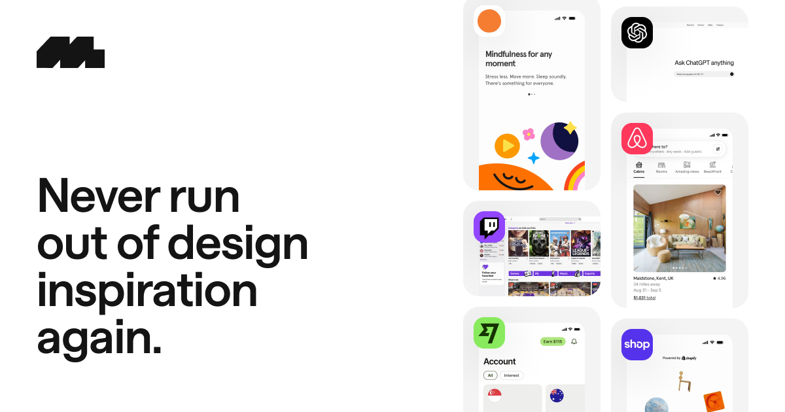

# Mobbin

> **URL:** https://mobbin.com · **Type:** Searchable library of shipped app & web screens/flows (600k+) · **Captured:** 2026-11-11
> 

## What it is
"Where teams and agents find designs that work." **600,000+ shipped screens**, new weekly, across **Apps, Sites, Screens, Flows, Animations, UI Elements**; full-text and element search (paywalls, onboarding, settings…). **Mobbin MCP** (Pro & Team plans) lets Cursor, ChatGPT, Claude, Figma, Grok agents query the library ("Show me how top apps design paywalls…"). Free tier limited; Pro/Team paid.

## Catalog / structure
| Facet | Details |
| :--- | :--- |
| Libraries | iOS apps · Android apps · Web apps · Sites |
| Facets | Screens (by pattern e.g. paywall, empty state), Flows (multi-screen journeys, recorded), UI Elements (buttons, sheets, tab bars), Animations |

## What to borrow
- **Flows** are the best reference for multi-screen journeys (onboarding, checkout) in `image-to-react` multi-screen builds.
- If the user has a Pro/Team plan, wire the **Mobbin MCP** into the `ui-libraries` plugin for agent research.
- Cite exact app + screen when critiquing patterns.

## API / MCP / access
✅ **Mobbin MCP** (mobbin.com/mcp, paid plans).
