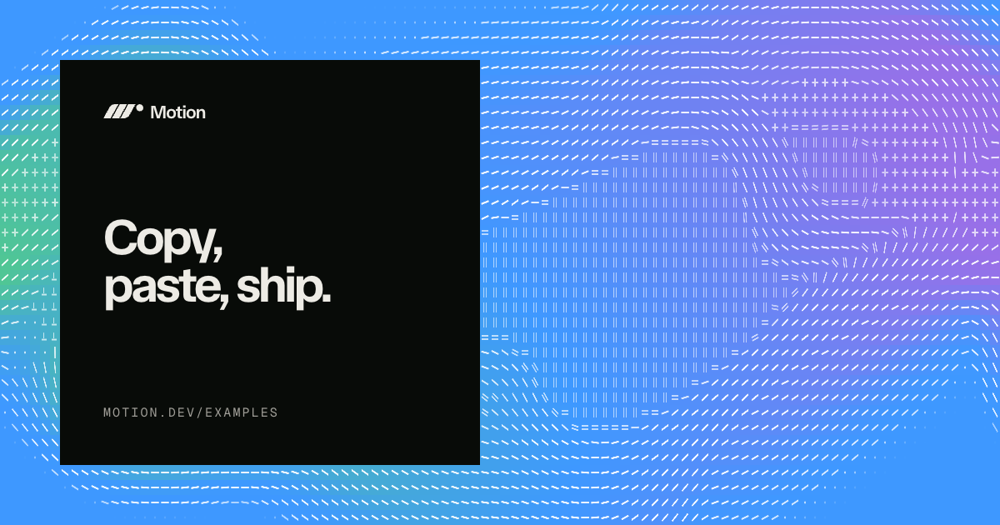

# Motion examples (motion.dev/examples)

> **URL:** https://motion.dev/examples · **Type:** Copy-paste animation snippets (React/JS/Vue) · **Captured:** 2026-11-11
> 

## What it is
"Production-ready snippets for Motion across React, JavaScript, and Vue." **300+ examples** (free + Motion+): layout animations, shared element, scroll-linked, gestures, carousels, tickers, cursors, text effects, SVG path drawing, springs. Ready to paste or adapt with AI (Motion MCP installed in kit as `motion`).

## Catalog / structure
| Facet | Details |
| :--- | :--- |
| Categories | Layout · Scroll · Gestures · Exit/AnimatePresence · SVG · Text · Carousel/Ticker · Cursor · 3D · Springs |

## What to borrow
- Start every Motion pattern here; use the `motion` MCP to search docs/examples.

## API / MCP / access
✅ Motion MCP (kit: `motion-craft` plugin).
