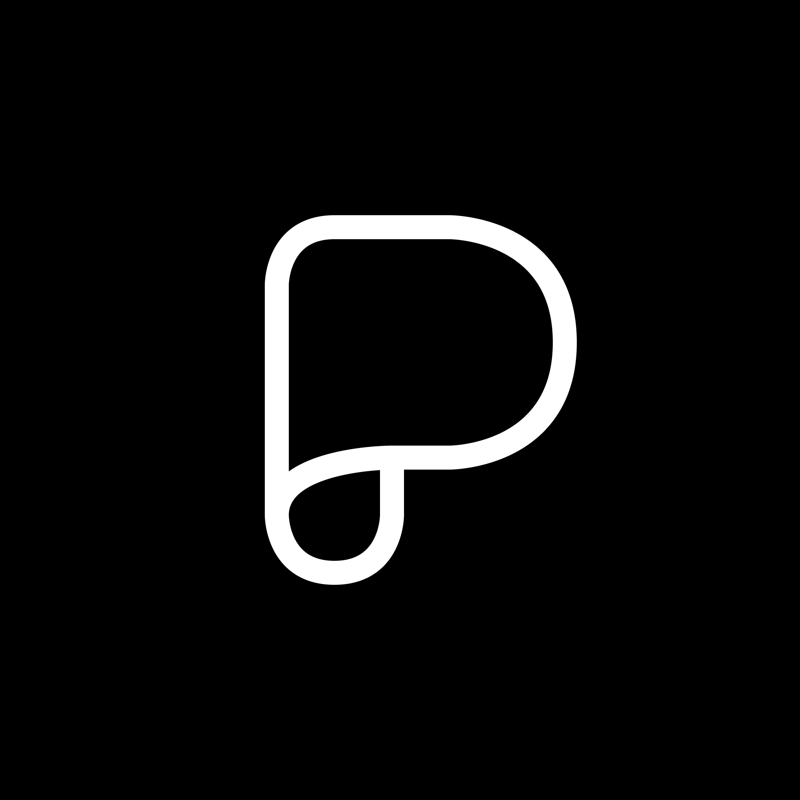

# Paco Coursey — paco.me

> **URL:** https://paco.me · https://paco.me/craft · **Captured:** 2026-11-11 · 

## Who
Design engineer, **Webmaster at Linear**; previously built the **Vercel design system, website and dashboard**. Author of **cmdk** (⌘K, composable command menu), **next-themes** (perfect dark mode), **Writer** (perf-focused plain-text editor).

## Craft (paco.me/craft) — full list
| Section | Piece | What it demonstrates |
| :--- | :--- | :--- |
| Motion | [Exclusion Tabs](https://paco.me/craft/tabs) | Stripe's smooth tabs using **WAAPI + clip-path** (duplicate highlighted layer clipped to active tab) |
| Motion | [iOS Dropdown Menu](https://paco.me/craft/ios-menu) | Nested dropdown flyout animation from iOS |
| CSS | [Blur](https://paco.me/craft/blur) | Better blur with `backdrop-filter` + SVG filters (progressive blur) |
| CSS | [Timeline](https://paco.me/craft/timeline) | Linear's roadmap timeline in pure CSS |
| CSS | [Spotify Filters](https://paco.me/craft/filter) | Filtering-chip pattern from Spotify iOS |
| CSS | [Carousel](https://paco.me/craft/carousel) | Naturally overflowing image collection (bleeds past container) |
| Interaction | [Video](https://paco.me/craft/video) | Custom player controls + keyboard shortcuts |
| Interaction | [Command Palette](https://paco.me/craft/command) | Modal combobox with compound API (cmdk patterns) |
| Interaction | [macOS Windows](https://paco.me/craft/windows) | Windows and animated sidebars |

Writing: *React Hook Getter Pattern* (state hook in 50 lines), *Redesign 2021* (return to simplicity).

## Style
Ultra-minimal text index, system-ish sans, generous leading, no imagery; credo "Pray at the altar of hard work."

## What to borrow
- **Compound component APIs** (`<Command.Input/>`, `<Command.List/>`) for any composite widget we build.
- **Exclusion tabs with WAAPI** (no library) and **overflowing carousels** as Golden Template interaction upgrades.
- **next-themes** approach (no-flash theme script) for dark mode in non-Next builds.

## Related
[emil-kowalski.md](emil-kowalski.md) · [rauno-devouring-details.md](rauno-devouring-details.md) · [ui-land.md](ui-land.md)
