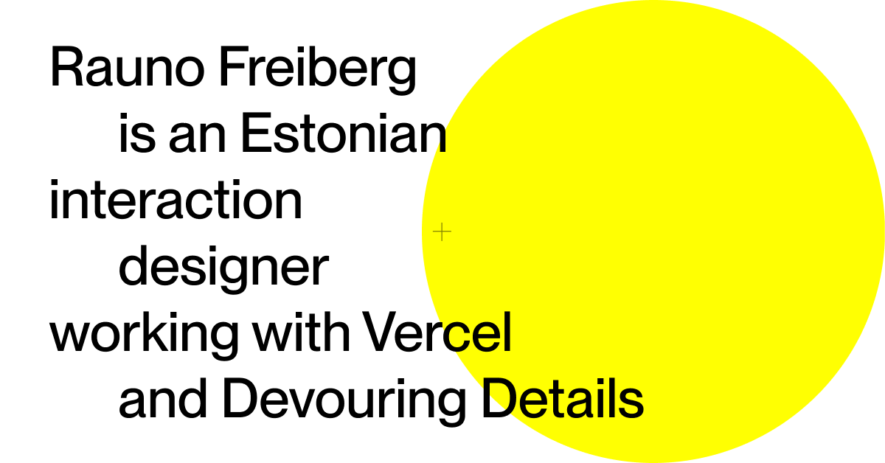
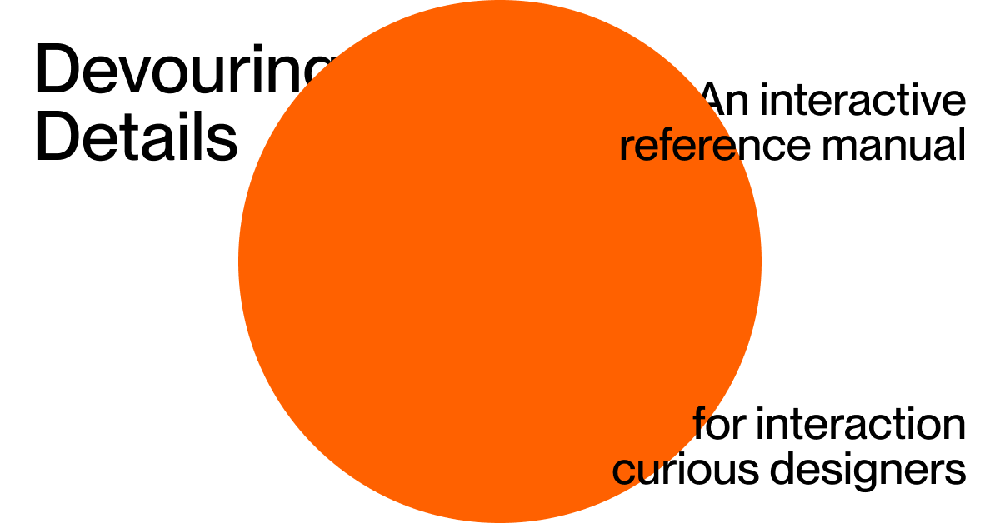

# Rauno Freiberg — rauno.me (+ Devouring Details)

> **URLs:** https://rauno.me · https://rauno.me/craft · https://devouringdetails.com · https://historyofsoftware.org · **Captured:** 2026-11-11
>  

## Who
Estonian interaction designer, **Staff Design Engineer at Vercel**; author of *Devouring Details* and *History of Software Design*. Manifesto on the homepage: "Make it fast. Make it beautiful. Make it consistent. Make it carefully. Make it timeless. Make it soulful. Make it." Site is a near-empty monochrome index; the craft page is the archive.

## Craft archive (rauno.me/craft) — ~80 pieces
Grouped from the live index (prototypes with source pages are marked ▶):

| Category | Pieces |
| :--- | :--- |
| **Inputs & controls** | ▶ Vanish Input · ▶ Wheel Input · ▶ Graph Slider · ▶ Adaptive Precision · Input · Hold Enter to confirm · Animated Checkboxes · Combobox · Countdown · Inline Conversion · Word Lookup |
| **Navigation & menus** | ▶ Exclusion Tabs · ▶ Radial Menu · ⌘K Breadcrumbs · Toolbar Morph · Sidebar · ▶ Minimap · Wheel Interface · Cryptic List · Browser History |
| **Tooltips / overlays** | Spatial Tooltip · Gooey Tooltip · X-Ray Interaction (vercel.com/security) · Preview Comments · Focus Reading |
| **Text & motion** | Staggered Text · Blur Reveal · Animated Typing · Blurred Icons · Theme Motion · Microinteractions I · ▶ Logo Carousel |
| **Shaders** | Gooey Shader · Tangerine Shader · Mirror Shader |
| **SwiftUI** | SwiftUI Dock · SwiftUI MercuryOS (w/ Jason Yuan) · SwiftUI Video Scrubber · SwiftUI Radial Menu |
| **Production (Vercel)** | ▶ Vercel Footer · Vercel Homepage · Next.js Conf 2022 · Next.js Dev Tools · Vercel Agent · ▶ What will you ship? · Arc Teaser · Undefined Branding · Signatures · Posters |
| **Essays** | ▶ Invisible Details of Interaction Design · ▶ Designing Depth · ▶ Contrasting Aesthetics · ▶ Novelty · Design Details |
| **Products** | Devouring Details · DD System · History of Software Design · ▶ Running Diary · User Interface Gallery |

## Devouring Details (devouringdetails.com)
"An interactive reference manual for interaction-curious designers" — **23 chapters, 23 downloadable React components**, non-linear, custom platform.
- **Principles:** Inferring intent · Interaction metaphors · Ergonomic interactions · Simulating physics · Motion choreography · Responsive interfaces · Contained gestures · Drawing inspiration
- **Prototypes (with source):** Line Minimap · Scroll Strip · Radial Timeline · Morph Surface · Line Graph · Next.js Dev Tools (free) · Logos Carousel · Motion React · Blur Reveal · Time Machine
- **Resources:** Behind the scenes (free) · Code snippets · Design workflow · Component library · Public bookmarks · FAQ · Design philosophy

## Key ideas (from "Invisible Details of Interaction Design" and DD)
- **Metaphors from the physical world** (momentum, rubber-banding, inertia) make gestures feel inevitable; respect *contained gestures* (a swipe shouldn't escape its surface).
- **Infer intent**: hover intent delays, predictive prefetch, cursor-direction triangles for submenus, larger hit areas than visuals.
- **Ergonomics**: place actions where the pointer/thumb already is; adaptive precision (slider gets finer the further you drag away vertically).
- **Frequency vs novelty** (essay *Novelty*): novelty is allowed where it is rare; daily tools stay quiet.
- **Depth** (essay): layered shadows + light source consistency + subtle blur for elevation.

## What to borrow
1. **Exclusion tabs / clip-path tabs**, **vanish input**, **hold-to-confirm**, **adaptive precision slider**, **radial menu** — all strong `interaction`-skill upgrade candidates.
2. Treat each prototype as **one principle demonstrated** → mirrors how our skills should cite a principle + demo.
3. Use DD's 8 principles as a **critique rubric** in `design-critique` for interaction quality.

## Related
[emil-kowalski.md](emil-kowalski.md) · [paco-coursey.md](paco-coursey.md) · [ui-land.md](ui-land.md)
