# experiments.thisiswhitespace.com — Zsolt Kacso

> **URL:** https://experiments.thisiswhitespace.com/ · **Author:** Zsolt Kacso ("I design and build interactive interfaces for startups", clients backed by YC) · **Captured:** 2026-11-11 · **Posters:** [screens/whitespace/](screens/whitespace/) (30 × 960×600 JPG, ~1.2 MB)

## TL;DR
A catalog of **30 shader/WebGL "interface experiments"** that turn ordinary product UI (toggles, progress bars, forms, sidebars, hero sections, cards, OTP codes) into **physical materials** — refractive glass, liquid, paper, smoke, fire, dots, vines. Every piece is still a *usable UI control*; the rendering is the novelty. It is the best current reference for **"tactile WebGL UI"** and for the experimental **HTML-in-Canvas** (WICG `drawElementImage`) API.

## Stack & technique fingerprint
Tag frequency across 30 entries:

| Tag | Count | Tag | Count |
| :--- | ---: | :--- | ---: |
| interactive | 19 | html-in-canvas | 5 (+ 5 more Chrome-only canvas) |
| threejs / three.js | 17 | transition | 5 |
| shader | 14 | particles | 4 |
| **dialkit** (live tuning panel) | 12 | glass | 3 |
| r3f | 11 | scroll | 3 |
| webgl | 10 | gsap | 2 |
| canvas | 10 | sdf / dispersion / audio / physics | 1 each |

- **Rendering:** three.js + React Three Fiber + drei for 3D; raw **WebGL / WebGL2 single fragment shaders with SDFs** for small controls (Liquid Tags, Glass Light Toggle) — no scene graph needed.
- **HTML-in-Canvas** (`drawElementImage`, Chrome flag/origin trial): live, interactive DOM rendered as a WebGL texture, then deformed (curl, Möbius, curtain fold, burn, dissolve). Pointer events are **ray-mapped back onto the deformed surface** so inputs still work. 10 entries are Chrome-only for this reason; graceful fallback = static snapshot after the effect (One-Time Code).
- **Materials:** `MeshPhysicalMaterial` transmission + dispersion (Glass Hero), per-wavelength dispersion + frost + softbox reflection in SDF shaders, PBR+IBL, matcap, parallax height maps, screen-space SSS on marching-cubes bodies (Abyssal Visitor), shell-textured moss + instanced foliage (Vine Overgrowth).
- **Simulation:** GPU fluid/combustion sim (One-Time Code), GPU particle sims releasing page pixels (Surface Dissolve), real pendulum physics (Pendant Lamp), spring-driven liquid blobs (Liquid Glass Recorder), luminance-based collision maps (Shader Cards).
- **Motion/choreography:** GSAP ScrollTrigger for landing sequences (Aphelion, Jungle Canopy, Lathe), springs + per-pixel stagger for morphs (Glass Light Toggle).
- **Craft details:** TPDF dithering to kill gradient banding (Dot Sphere Card); "one glow model" tuned to read equally on light and dark; labels slide out as a check draws in; responsive fallbacks (Liquid Tags shows last two steps on phones).
- **Tuning:** nearly every piece exposes **DialKit** (Josh Puckett's panel) — e.g. "65 live parameters" on the Liquid Glass Recorder. Commercial: Liquid Glass Recorder sells on Gumroad for $15.

## Full catalog (30)

| # | Experiment | Date | Type | One-liner | Tags | Poster |
| ---: | :--- | :--- | :--- | :--- | :--- | :--- |
| 1 | [Liquid Glass Recorder](https://experiments.thisiswhitespace.com/liquid-glass-recorder) | 2026-10 | product | A voice button made of liquid glass that bends toward your cursor and glows when you talk. | `webgl, shader, audio, interactive` | 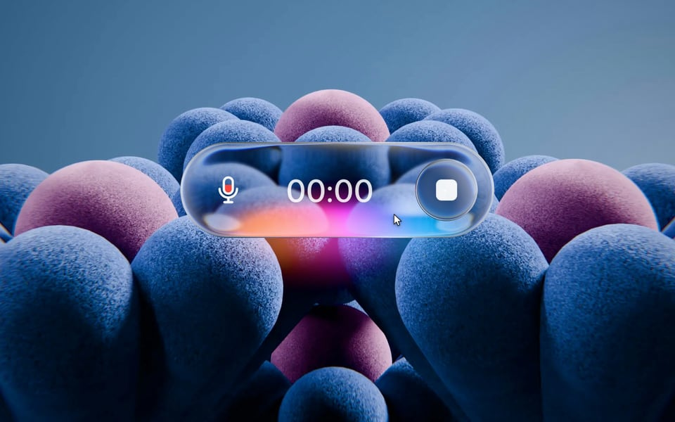 |
| 2 | [Aphelion](https://aphelion-seven.vercel.app) | 2026-10 | landing-page | A full launch page: an astronaut tumbles past an eclipsed planet as you scroll. | `threejs, landing, scroll, gsap` | 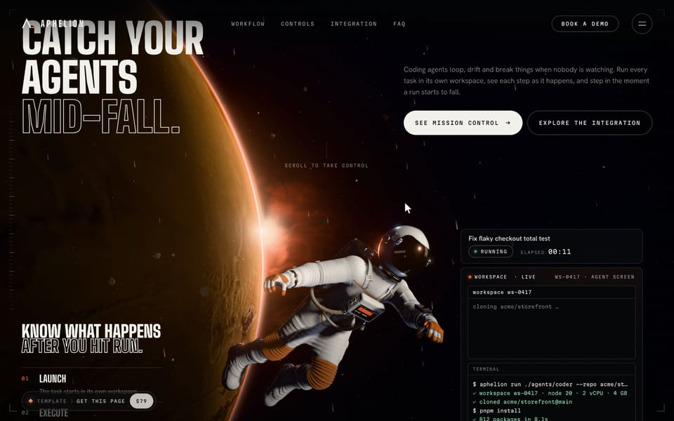 |
| 3 | [Abyssal Visitor](https://experiments.thisiswhitespace.com/cephalopod) | 2026-08 | experiment | A deep-sea creature that swims around the page and follows your cursor. | `r3f, threejs, shader, interactive, dialkit` | 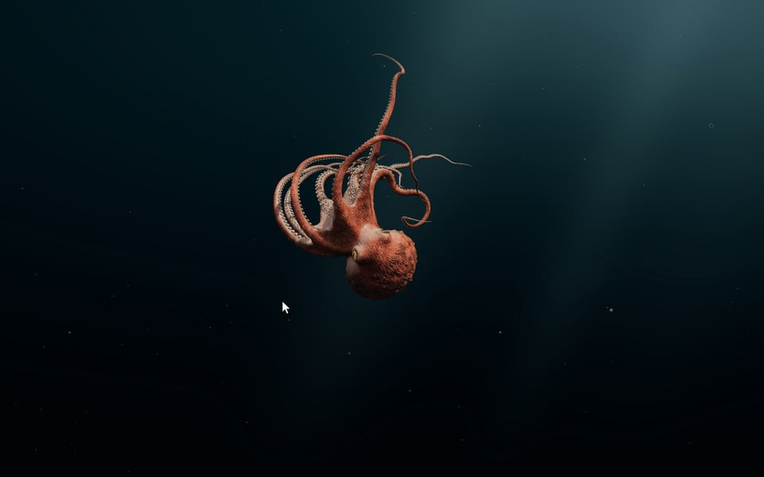 |
| 4 | [Vine Overgrowth](https://experiments.thisiswhitespace.com/vine-overgrowth) | 2026-08 | experiment | Living vines grow over a moving landing page and reach for your cursor. | `threejs, r3f, shader, generative, interactive, particles, dialkit` | 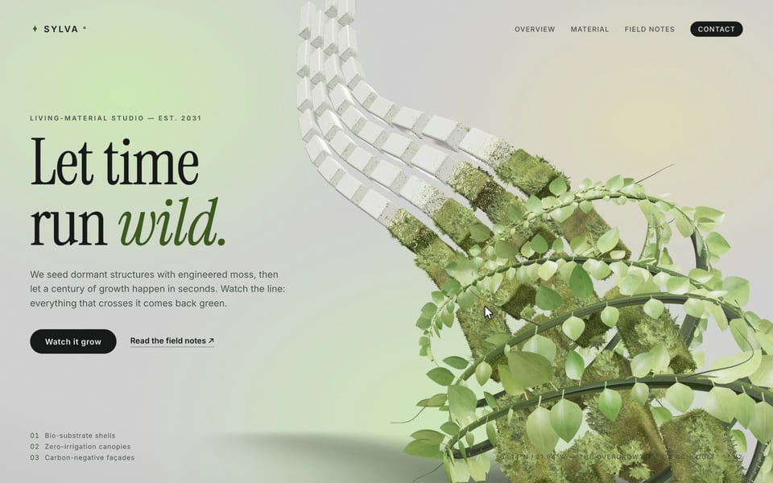 |
| 5 | [Surface Dissolve](https://experiments.thisiswhitespace.com/surface-dissolve) | 2026-08 | experiment | A landing page that curls like paper and dissolves into smoke as you scroll. | `threejs, html-in-canvas, shader, particles, scroll, interactive, dialkit` (Chrome-only) | 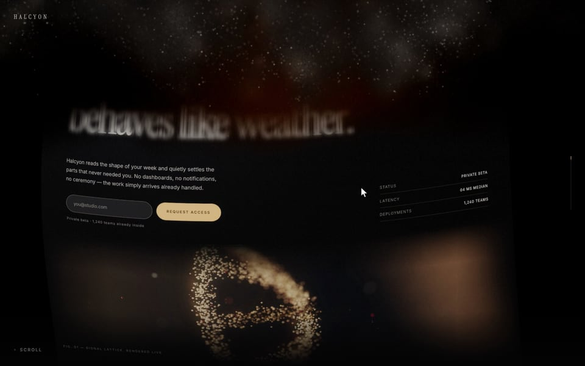 |
| 6 | [Liquid Tags](https://experiments.thisiswhitespace.com/liquid-tags) | 2026-11 | experiment | A glass progress bar whose steps reach for each other and fuse like liquid as you fill them. | `webgl, shader, glass, sdf, progress, interactive` | 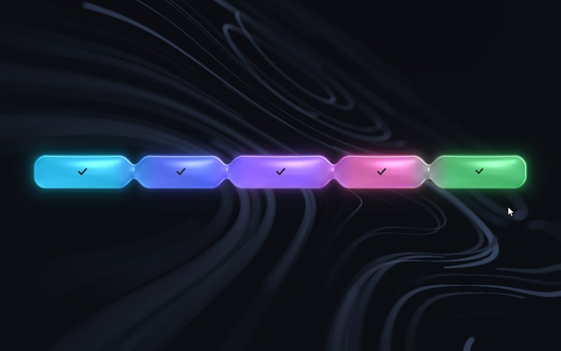 |
| 7 | [Glass Light Toggle](https://experiments.thisiswhitespace.com/glass-light-toggle) | 2026-11 | experiment | A glass dark-mode switch lit from its edge. Drag it and the pixels rebuild moon into sun. | `webgl, shader, glass, toggle, interactive` | 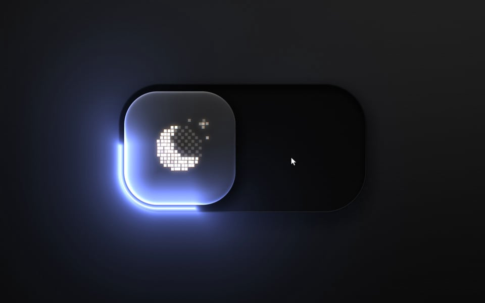 |
| 8 | [Lathe](https://experiments.thisiswhitespace.com/lathe-blueprint) | 2026-11 | experiment | A blueprint hero that draws itself. Hover to reveal the real drone, click and it takes off. | `three.js, webgl, shader, hero, interactive, dialkit` | 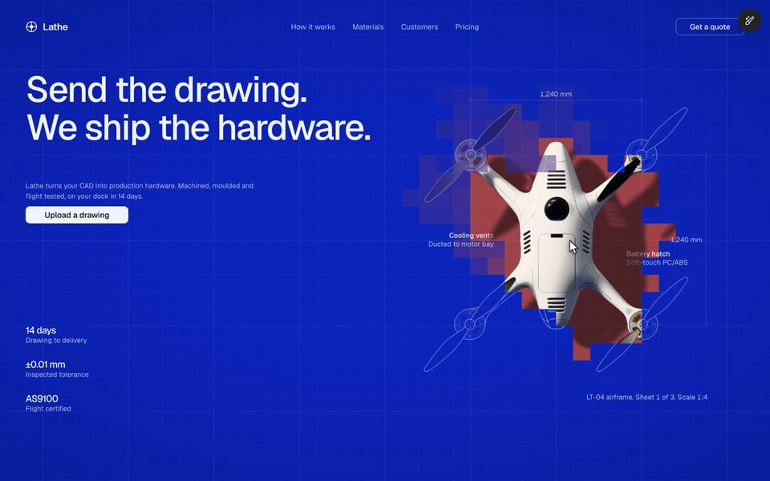 |
| 9 | [Dot Sphere Card](https://experiments.thisiswhitespace.com/dot-sphere-card) | 2026-08 | experiment | A sci-fi card whose sphere of dots turns to watch you, with asteroids on hover. | `threejs, canvas, css-3d, video, interactive, dialkit` | 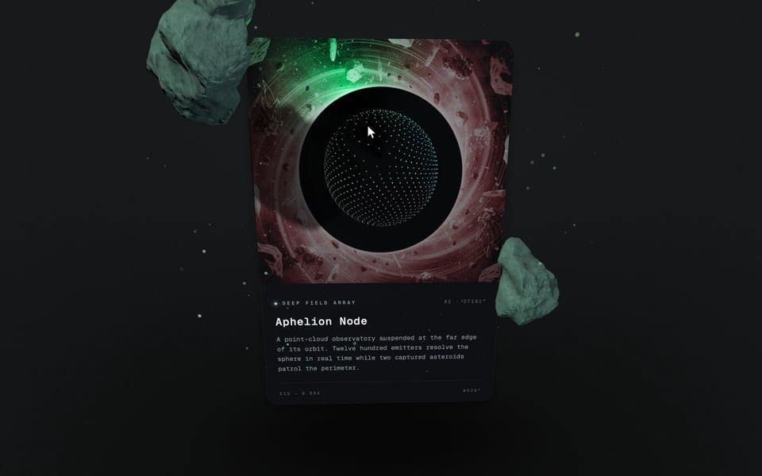 |
| 10 | [One-Time Code](https://experiments.thisiswhitespace.com/one-time-code) | 2026-11 | experiment | An activation code that catches fire once you've seen it. Copy it before it burns. | `canvas, webgl, shader, simulation, interactive, dialkit` | 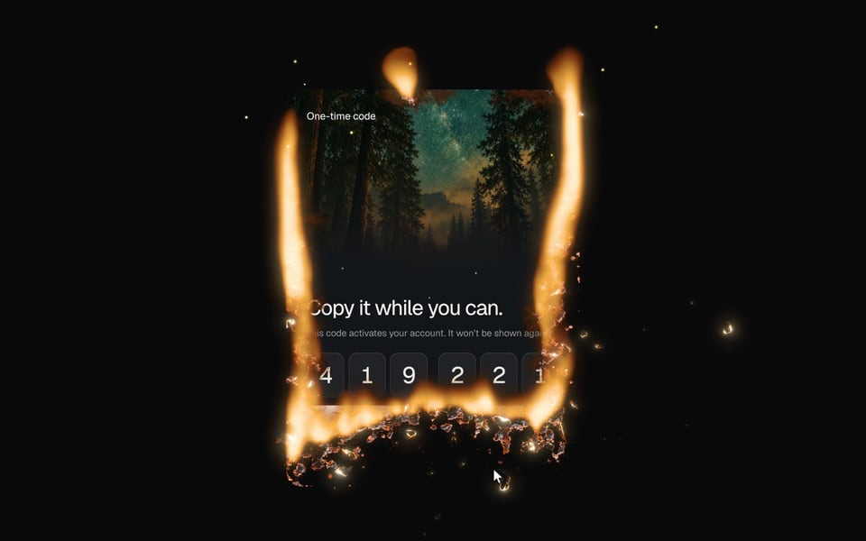 |
| 11 | [Glass Hero](https://experiments.thisiswhitespace.com/glass-hero) | 2026-05 | experiment | A hero section behind shards of real glass that bend and split the light. | `r3f, threejs, html-in-canvas, glass, dispersion, dialkit` (Chrome-only) | 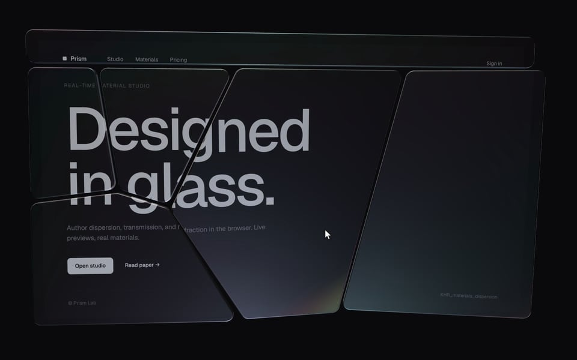 |
| 12 | [Jungle Cursor Canopy](https://experiments.thisiswhitespace.com/jungle-cursor-canopy) | 2026-07 | experiment | A dense jungle canopy that parts around your cursor, then lifts away. | `threejs, shader, interactive, generative, particles, gsap` | 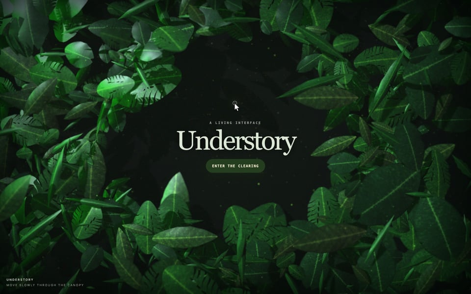 |
| 13 | [Pendant Lamp](https://experiments.thisiswhitespace.com/pendant-lamp) | 2026-07 | experiment | A swinging lamp lights up a dark landing page. Grab it and throw it. | `r3f, threejs, canvas, webgl, physics, experimental` (Chrome-only) | 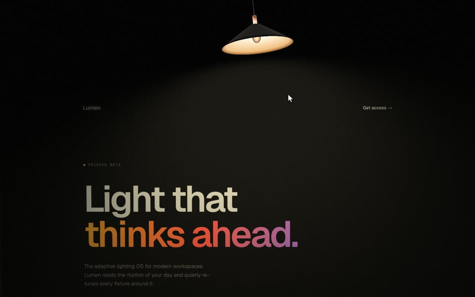 |
| 14 | [Action Wheel](https://experiments.thisiswhitespace.com/action-wheel) | 2026-07 | experiment | A game-style radial menu: hold to open it, flick toward an action, let go. | `r3f, threejs, shader, interactive, ui-control, dialkit` | 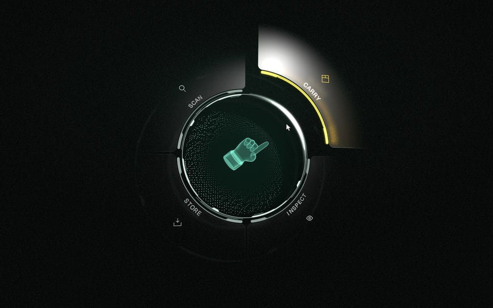 |
| 15 | [Cuboid Chain](https://experiments.thisiswhitespace.com/cuboid-chain) | 2026-06 | experiment | A row of 3D blocks rolling in a wave, each face carrying a product card. | `r3f, threejs, 3d, cards, lighting, dialkit` | 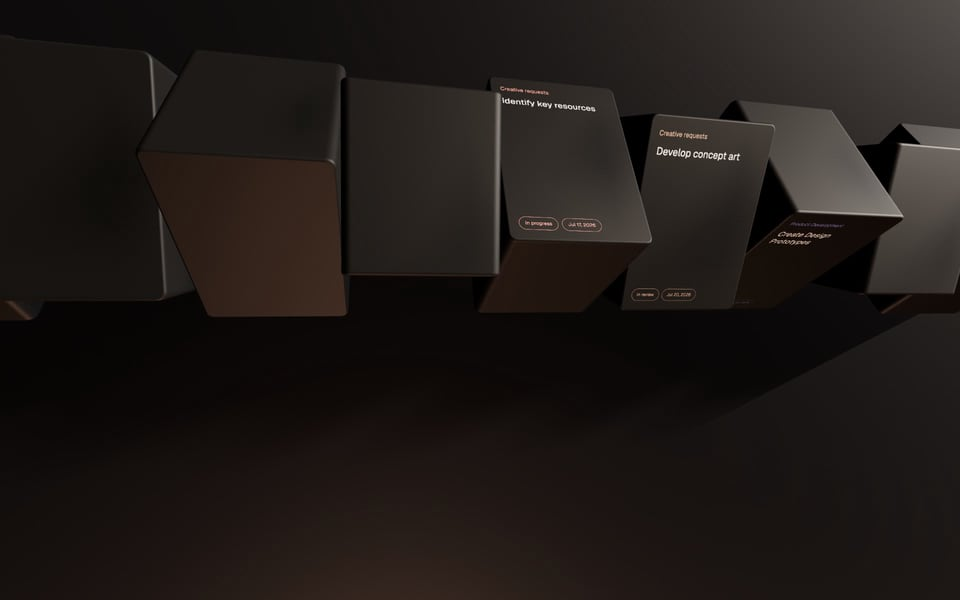 |
| 16 | [Trace Cards](https://experiments.thisiswhitespace.com/trace-cards) | 2026-05 | experiment | Cards that tilt toward your cursor and trail glowing copies of themselves. | `cards, r3f, wireframe, hover, dialkit, three.js` | 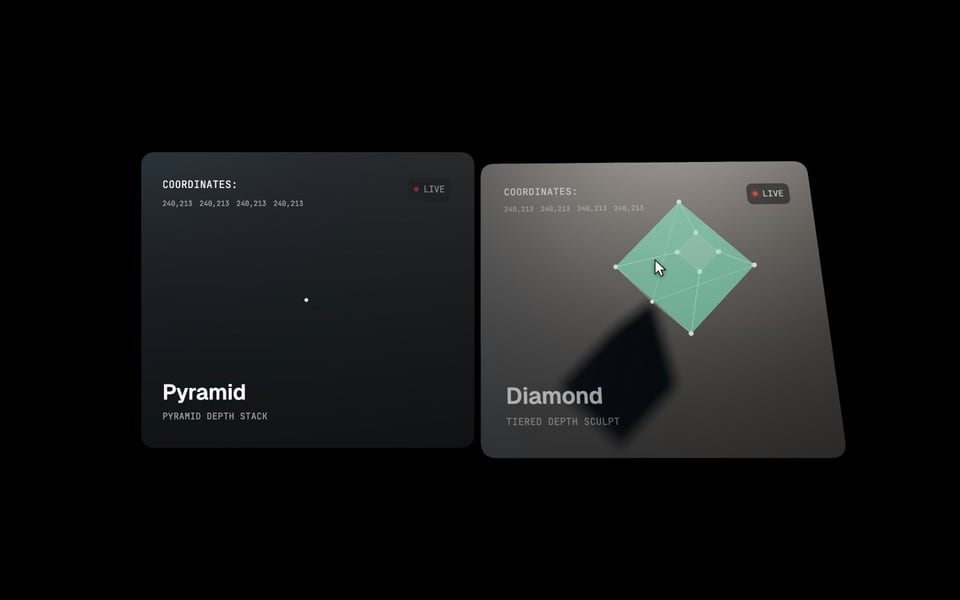 |
| 17 | [Pattern Cards](https://experiments.thisiswhitespace.com/pattern-cards) | 2026-05 | experiment | Three bold feature cards with dot-pattern art, built from a Figma layout. | `layout, cards, static` | 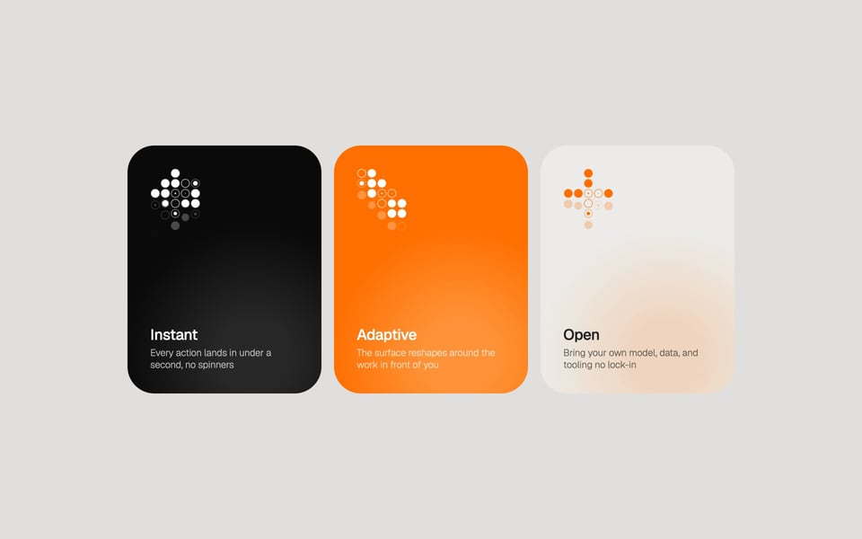 |
| 18 | [Twisting Ribbons](https://experiments.thisiswhitespace.com/twisting-ribbons) | 2026-05 | experiment | A row of ribbons twisting in sequence, drawing shapes in the gaps between them. | `r3f, threejs, shader, dialkit` | 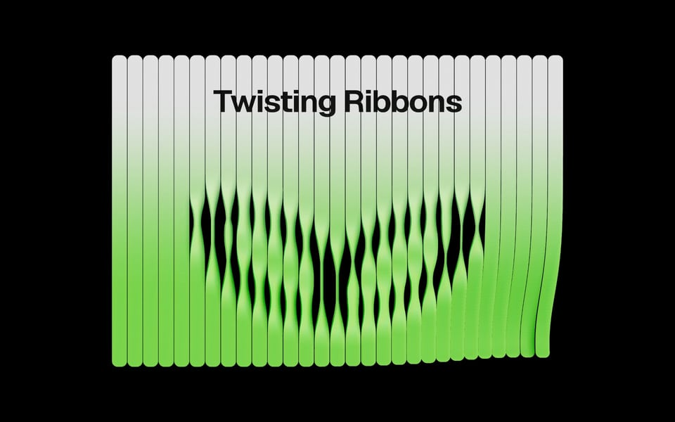 |
| 19 | [Dot Form 3D](https://experiments.thisiswhitespace.com/dot-form) | 2026-04 | experiment | A form that lifts into 3D when you click it; your words rise out of a field of dots. | `html-in-canvas, threejs, r3f, transition, interactive` (Chrome-only) | 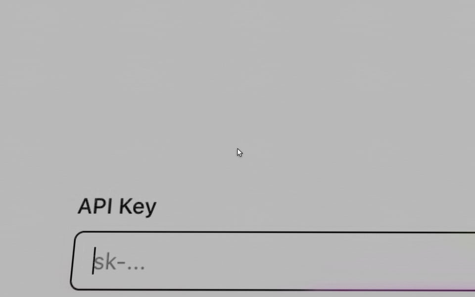 |
| 20 | [Shader Deck](https://experiments.thisiswhitespace.com/shader-deck) | 2026-04 | experiment | Slides orbit through a glowing portal as you scroll. | `threejs, r3f, html-in-canvas, shader, carousel, dialkit` (Chrome-only) | 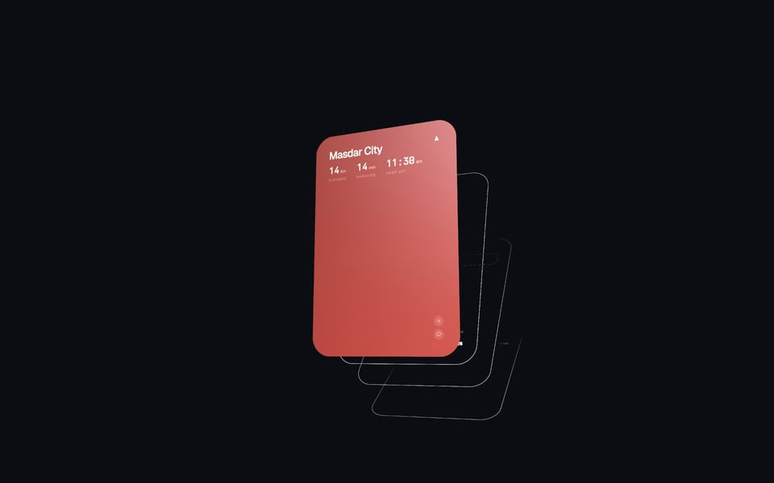 |
| 21 | [Code Slice Hero](https://experiments.thisiswhitespace.com/code-slice-hero) | 2026-04 | experiment | A landing page that shatters into tiles to reveal a live terminal underneath. | `threejs, r3f, html-in-canvas, landing, shader` (Chrome-only) | 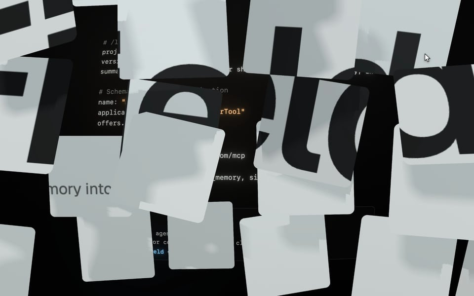 |
| 22 | [Dot Phone Carousel](https://experiments.thisiswhitespace.com/dot-phone-carousel) | 2026-04 | experiment | Screens glide behind a phone and scan into it as you flip through them. | `canvas, interactive, carousel, transition` | 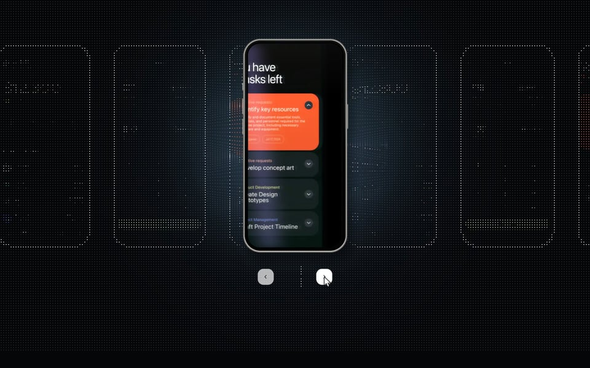 |
| 23 | [Cursor Nav](https://experiments.thisiswhitespace.com/cursor-nav) | 2026-04 | experiment | Click and your cursor blooms into a 3D menu you steer by moving up and down. | `interactive, 3d, ui, transition` | 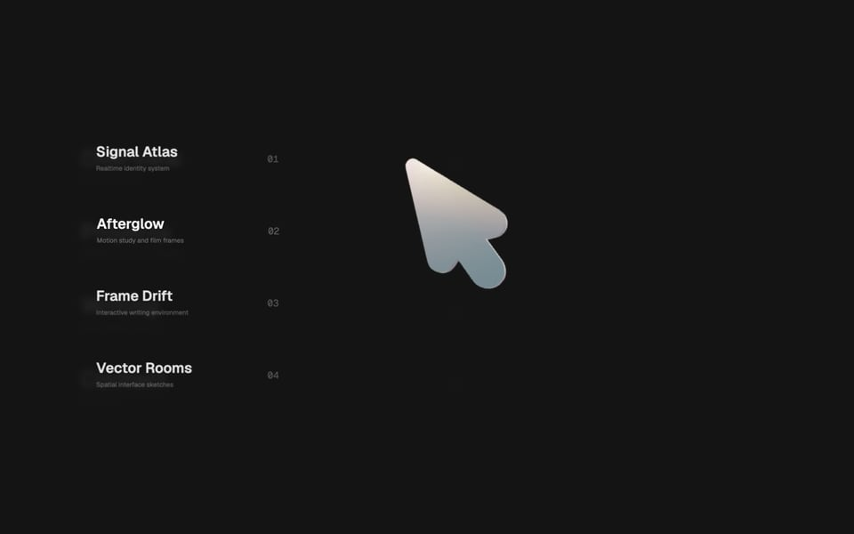 |
| 24 | [Particle Phones](https://experiments.thisiswhitespace.com/particle-phones) | 2026-04 | experiment | As you scroll, a cloud of particles snaps into each new phone screen. | `canvas, scroll, particles, interactive` | 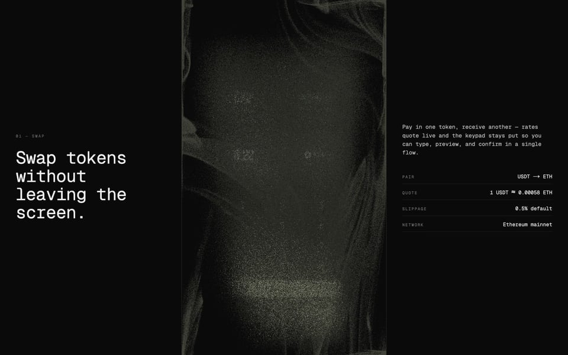 |
| 25 | [Dot Hover Cards](https://experiments.thisiswhitespace.com/dot-hover-cards) | 2026-04 | experiment | A page drawn in dots: hover to light up a card, click to bring it into focus. | `canvas, interactive, transition` | 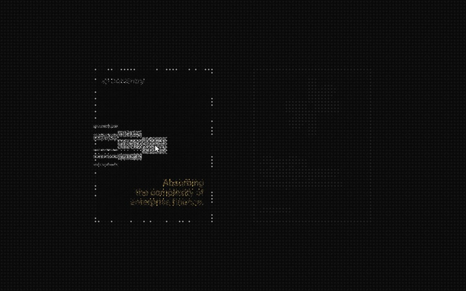 |
| 26 | [Curtain Sidebar](https://experiments.thisiswhitespace.com/curtain-sidebar) | 2026-04 | experiment | Peel the page back like paper from the left edge to reveal the sidebar. | `canvas, webgl, experimental, interactive` (Chrome-only) | 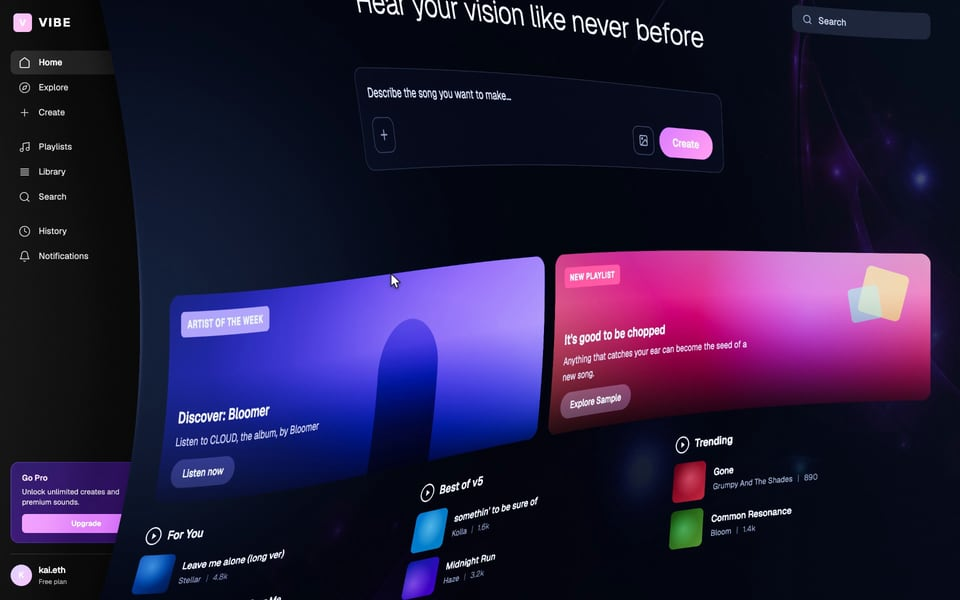 |
| 27 | [Mobius Strip](https://experiments.thisiswhitespace.com/mobius-strip) | 2026-04 | experiment | A landing page wrapped around a Möbius strip. Scroll to travel along it. | `canvas, webgl, 3d, experimental` (Chrome-only) | 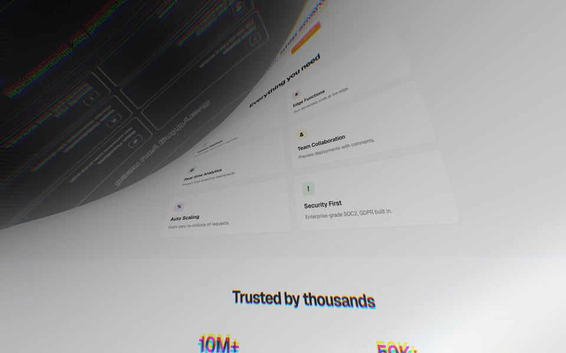 |
| 28 | [Shader Cards](https://experiments.thisiswhitespace.com/shader-cards) | 2026-04 | experiment | A landing page that assembles itself out of flying particles as you scroll. | `canvas, webgl, shader, experimental` (Chrome-only) | 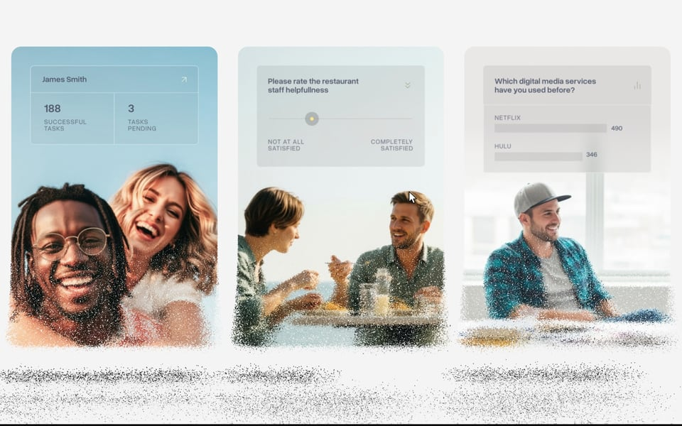 |
| 29 | [HTML in Canvas](https://experiments.thisiswhitespace.com/html-in-canvas) | 2026-04 | experiment | A portal follows your cursor and reveals a clean interface inside a particle field. | `canvas, webgl, experimental, interactive` (Chrome-only) | 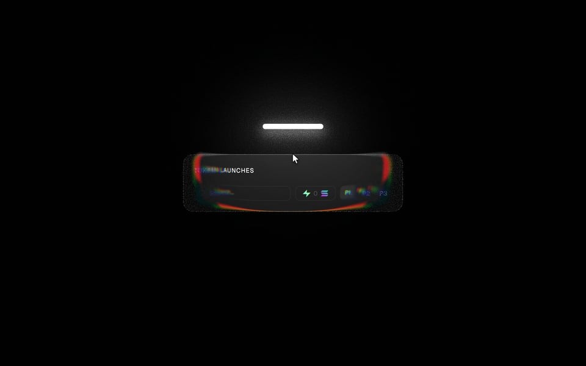 |
| 30 | [Viewport Transition](https://experiments.thisiswhitespace.com/viewport-transition) | 2026-04 | experiment | A flat marketing page that unfolds into a glowing 3D wireframe world. | `threejs, 3d, interactive, transition` | 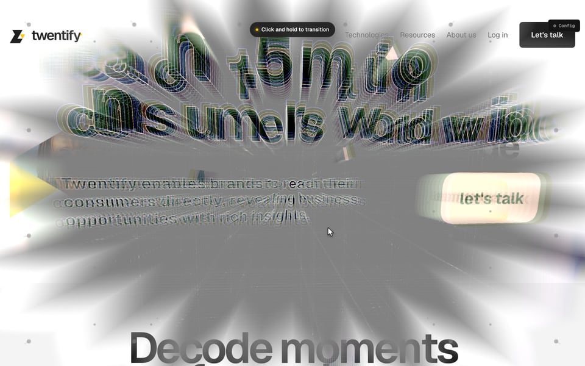 |

## Groupings by UI role
| UI role | Experiments |
| :--- | :--- |
| **Controls** (toggle, progress, record, radial menu, OTP) | Glass Light Toggle, Liquid Tags, Liquid Glass Recorder, Action Wheel, One-Time Code, Cursor Nav |
| **Hero sections / landing pages** | Aphelion, Lathe, Glass Hero, Code Slice Hero, Jungle Cursor Canopy, Pendant Lamp, Vine Overgrowth, Viewport Transition, Surface Dissolve, Mobius Strip |
| **Cards** | Dot Sphere Card, Trace Cards, Pattern Cards, Cuboid Chain, Dot Hover Cards, Shader Cards |
| **Carousels / scroll sequences** | Shader Deck, Dot Phone Carousel, Particle Phones, Twisting Ribbons |
| **Navigation / layout** | Curtain Sidebar, Cursor Nav, Dot Form 3D |
| **Ambient characters** | Abyssal Visitor (cephalopod) |

## What to borrow (for Golden Template / 3d-photoreal builds)
1. **Single-shader controls.** A toggle or progress bar can be one full-quad fragment shader with SDF shapes — no three.js needed (~5–10 kB). Use `ogl` or a raw WebGL2 context in a `<canvas>` sized to the control; keep a real `<button role="switch">` / `<progress>` underneath for a11y and keyboard.
2. **Material over motion.** The delight comes from *refraction, frost, dispersion, glow* reacting to pointer/press — not from long animations. Animation stays short and spring-driven; scrubbable by drag (half-dragged toggle holds the morph mid-flight).
3. **One glow model for both themes.** Tune emissive/glow so it reads equally on light and dark backgrounds — a reusable rule for any theme-switching effect.
4. **Dither your gradients** (TPDF noise) to avoid banding in dark heroes.
5. **Progressive enhancement for HTML-in-Canvas.** Feature-detect `drawElementImage`; fall back to a static snapshot or plain DOM. Keep pointer events mapped to the real DOM.
6. **Expose every parameter on a panel** (DialKit / Leva) during build, then bake chosen values — the "65 live parameters" approach is how these feel so dialed.
7. **Responsive simplification**, not removal: Liquid Tags shows 2 steps on phones; Lathe stacks on tablets.
8. **Hero recipe (Aphelion):** Vite + three.js + GSAP ScrollTrigger + self-hosted fonts, rigged GLB character, slow morphing glow — directly reusable with the `3d.md` asset pipeline (meshopt + KTX2).

## Related kit pieces
- Libraries: [../../libraries/3d.md](../../libraries/3d.md) (R3F, drei, postprocessing, OGL), [../../libraries/motion.md](../../libraries/motion.md) (GSAP, DialKit, Leva)
- Skills: `image-to-working-model`, `declarative-photoreal-threejs-worlds`, `feel`, `animation-performance`
- Subagent: `3d-research` (nightly crawl — add this site to its sources)

---

## Per-experiment detail (author descriptions)

### 1. Liquid Glass Recorder — `liquid-glass-recorder`

- **Link:** https://experiments.thisiswhitespace.com/liquid-glass-recorder
- **Tags:** webgl, shader, audio, interactive
- **Description (author):** The voice button for AI apps. Bends under your cursor, glows when you talk. Real refraction through a glass slab, a spring-driven liquid shape that reaches for the pointer, and a recording glow driven by six bands of your microphone. 65 live parameters.

### 2. Aphelion — `aphelion`

- **Link:** https://aphelion-seven.vercel.app
- **Tags:** threejs, landing, scroll, gsap
- **Description (author):** A complete, responsive launch page for an agent-infrastructure brand, built around a live 3D scene: a rigged astronaut in freefall in front of an eclipsed planet with a slowly morphing red glow. Vite + three.js, GSAP ScrollTrigger, self-hosted fonts.

### 3. Abyssal Visitor — `cephalopod`

- **Link:** https://experiments.thisiswhitespace.com/cephalopod
- **Tags:** r3f, threejs, shader, interactive, dialkit
- **Description (author):** A cephalopod that explores the page. Five render stacks — PBR+IBL, matcap, parallax height maps, transmission, and screen-space SSS — on one organic marching-cubes body.

### 4. Vine Overgrowth — `vine-overgrowth`

- **Link:** https://experiments.thisiswhitespace.com/vine-overgrowth
- **Tags:** threejs, r3f, shader, generative, interactive, particles, dialkit
- **Description (author):** A conveyor of bricks rides curved 3D tracks while braided procedural vines wrap the moving band — growing tips pinned mid-stream, leaning toward the cursor, coils screwing forward forever. Bricks crossing the growth zone are engulfed by shell-textured moss and instanced plant clumps under a domain-warped growth front, all cast onto the page by a contact shadow. A v2 mode (footer switch) adds analytic brick colliders the vines grip, plus seeking branch tendrils that latch onto passing bricks — each touch point seeding that brick's transformation.

### 5. Surface Dissolve — `surface-dissolve`

- **Link:** https://experiments.thisiswhitespace.com/surface-dissolve
- **Tags:** threejs, html-in-canvas, shader, particles, scroll, interactive, dialkit (Chrome-only, html-in-canvas)
- **Description (author):** A landing page rendered onto a curling 3D sheet via html-in-canvas dissolves into smoke as it scrolls through a fixed altitude band — a GPU particle sim releases page pixels as grains that cross-dissolve with a soft, wandering erosion front (no hard edge anywhere). The hero's email field is live: the pointer is ray-mapped onto the deformed surface for hover and real typing.

### 6. Liquid Tags — `liquid-tags`

- **Link:** https://experiments.thisiswhitespace.com/liquid-tags
- **Tags:** webgl, shader, glass, sdf, progress, interactive
- **Description (author):** A five-step progress indicator drawn in a single WebGL2 fragment shader with signed distance fields. Each tag is a slab of glass over a photo backdrop: its height comes from a crease-free interior field, so the surface is one smooth pillow, and it refracts the backdrop with per-wavelength dispersion, frost and a reflected studio softbox. Filling is one continuous liquid front; between tags, magnetic buds reach for each other, snap into a neck with a springy fillet, and on the way back stretch, pinch and recoil. Hovering previews the next step: the buds follow the cursor's height, a filled tag dents inward under the cursor to preview draining, and a fused neck can be plucked. Clear and filled glass are two separately tuned materials that blend through a soft wash of light, which only shows while you hover or while the bar moves. Labels slide away as a check draws in. On phones it shows the last two steps.

### 7. Glass Light Toggle — `glass-light-toggle`

- **Link:** https://experiments.thisiswhitespace.com/glass-light-toggle
- **Tags:** webgl, shader, glass, toggle, interactive
- **Description (author):** A light/dark toggle with a glass knob, drawn in a single WebGL fragment shader: a rounded-square lens whose bevel refracts (with a touch of chromatic aberration) and frosts what sits beneath it. A light strip hugs the glass and orbits it as you switch, bottom for night, top for day, scattering into the glass, washing the track and spilling onto the page; one glow model keeps it equally bold on the dark and light background. The icons are a pixel matrix behind the glass: every moon pixel is paired with a sun pixel by angle, and the morph is scrubbed by the knob's position with per-pixel stagger, a swirl and a spring each, so dragging halfway holds the swarm mid-flight.

### 8. Lathe — `lathe-blueprint`

- **Link:** https://experiments.thisiswhitespace.com/lathe-blueprint
- **Tags:** three.js, webgl, shader, hero, interactive, dialkit
- **Description (author):** A hardware startup's hero where the technical drawing draws itself and a square-by-square mask reveals the real part beneath. Click and the page tilts into 3D: a hand-built drone lifts off and follows the cursor, its rotors bending the page and blowing the extruded headline letters around. Three.js with a fixed sun and real shadows, rotor air done as a localised smear on the page, letters extruded from the font's own outlines, GSAP entry, and every value on a DialKit panel. Lays out on the sheet's grid at any size, stacking on tablets and phones.

### 9. Dot Sphere Card — `dot-sphere-card`

- **Link:** https://experiments.thisiswhitespace.com/dot-sphere-card
- **Tags:** threejs, canvas, css-3d, video, interactive, dialkit
- **Description (author):** A futuristic HUD card in CSS 3D: a cursor-reactive dot sphere floats over a tinted video layer while two textured asteroid GLBs orbit out from behind the card on hover — real shadow-mapped shadows, a center-pinned cursor-tracking spotlight, hover-reveal choreography per layer, and a TPDF-dithered background that kills gradient banding.

### 10. One-Time Code — `one-time-code`

- **Link:** https://experiments.thisiswhitespace.com/one-time-code
- **Tags:** canvas, webgl, shader, simulation, interactive, dialkit
- **Description (author):** A real HTML card that burns away: a GPU fluid simulation of air, gas and combustion runs over it, charring the surface, eating through it and shedding curled, glowing flakes that your cursor can blow around. In browsers with HTML-in-Canvas the live card is the WebGL texture; elsewhere a snapshot of the same HTML takes over once the reveal has finished.

### 11. Glass Hero — `glass-hero`

- **Link:** https://experiments.thisiswhitespace.com/glass-hero
- **Tags:** r3f, threejs, html-in-canvas, glass, dispersion, dialkit (Chrome-only, html-in-canvas)
- **Description (author):** A live HTML hero section sits behind floating glass shapes that refract and split light into chromatic fringes. Real-time dispersion via MeshPhysicalMaterial — drag to reposition the glass, tune IOR/thickness/dispersion in dialkit.

### 12. Jungle Cursor Canopy — `jungle-cursor-canopy`

- **Link:** https://experiments.thisiswhitespace.com/jungle-cursor-canopy
- **Tags:** threejs, shader, interactive, generative, particles, gsap
- **Description (author):** A dense procedural jungle canopy parts around the cursor, then lifts and spirals past the camera through a GSAP-choreographed landing sequence. Three.js leaves combine generated species silhouettes, physical materials, spatial gusts, depth of field, and a configurable field of glowing air motes.

### 13. Pendant Lamp — `pendant-lamp`

- **Link:** https://experiments.thisiswhitespace.com/pendant-lamp
- **Tags:** r3f, threejs, canvas, webgl, physics, experimental (Chrome-only, html-in-canvas)
- **Description (author):** A pendant lamp on a real pendulum physically lights an HTML page rendered into WebGL via html-in-canvas. Outside the beam the page falls dark — dim grayscale with blur, stroked outline, halftone, CRT, dither and more — and the swinging light reveals the true page. Grab and throw the lamp; hover a button and the beam aims at it.

### 14. Action Wheel — `action-wheel`

- **Link:** https://experiments.thisiswhitespace.com/action-wheel
- **Tags:** r3f, threejs, shader, interactive, ui-control, dialkit
- **Description (author):** A game-style radial action wheel. Click and hold to summon a layered circular control — a noise-animated dot grid, a segmented variable-stroke ring, and four independent quadrants that light up as a cursor-chasing glow orbits the rim. The whole wheel tilts in 3D toward the cursor; release over a quadrant to confirm.

### 15. Cuboid Chain — `cuboid-chain`

- **Link:** https://experiments.thisiswhitespace.com/cuboid-chain
- **Tags:** r3f, threejs, 3d, cards, lighting, dialkit
- **Description (author):** A horizontal chain of rounded cuboids whose front faces carry Figma task-card art. Each cuboid barrel-rolls on the horizontal axis with a staggered phase, lit by a top/bottom/side-key rig. Cuboid dimensions, gap, rotation speed/stagger, and every light are DialKit-controlled.

### 16. Trace Cards — `trace-cards`

- **Link:** https://experiments.thisiswhitespace.com/trace-cards
- **Tags:** cards, r3f, wireframe, hover, dialkit, three.js
- **Description (author):** Pyramid and diamond cards with cursor-driven tilt, depth sculpts, and streaming duplicate layers. R3F formation over HTML chrome with DialKit controls.

### 17. Pattern Cards — `pattern-cards`

- **Link:** https://experiments.thisiswhitespace.com/pattern-cards
- **Tags:** layout, cards, static
- **Description (author):** Three tall feature cards in black, orange, and warm gray. Each carries a distinct dot pattern (arrow wedge, diagonal cascade, plus) and a bottom-left title — direct port of a Figma layout.

### 18. Twisting Ribbons — `twisting-ribbons`

- **Link:** https://experiments.thisiswhitespace.com/twisting-ribbons
- **Tags:** r3f, threejs, shader, dialkit
- **Description (author):** A row of thin vertical ribbons twist around their Y-axis, progressing from edge-on at the left to face-on (and past) at the right. A twist band blends two materials top-to-bottom, and the negative space between neighbors forms vesica-shaped voids.

### 19. Dot Form 3D — `dot-form`

- **Link:** https://experiments.thisiswhitespace.com/dot-form
- **Tags:** html-in-canvas, threejs, r3f, transition, interactive (Chrome-only, html-in-canvas)
- **Description (author):** A shadcn-style form lifts into a tilted 3D scene on focus. Input and checkbox become extruded outlines, the button gains thickness, and typed characters render as a dot-relief at varying heights.

### 20. Shader Deck — `shader-deck`

- **Link:** https://experiments.thisiswhitespace.com/shader-deck
- **Tags:** threejs, r3f, html-in-canvas, shader, carousel, dialkit (Chrome-only, html-in-canvas)
- **Description (author):** A 3D carousel of HTML slides arranged on a ring in 3D space, scrolling through a glowing portal plane with volumetric light, fog, bloom, and chromatic aberration. Built with R3F, drei, and html-in-canvas.

### 21. Code Slice Hero — `code-slice-hero`

- **Link:** https://experiments.thisiswhitespace.com/code-slice-hero
- **Tags:** threejs, r3f, html-in-canvas, landing, shader (Chrome-only, html-in-canvas)
- **Description (author):** A landing page that hovers, lifts, and shatters into a grid of tiles to reveal an agent surface document and a working terminal.

### 22. Dot Phone Carousel — `dot-phone-carousel`

- **Link:** https://experiments.thisiswhitespace.com/dot-phone-carousel
- **Tags:** canvas, interactive, carousel, transition
- **Description (author):** A centered phone mockup with a crisp screen while dotted preview images glide behind it on a horizontal carousel. Cycle left and right to pull each image through the phone with a futuristic scan transition.

### 23. Cursor Nav — `cursor-nav`

- **Link:** https://experiments.thisiswhitespace.com/cursor-nav
- **Tags:** interactive, 3d, ui, transition
- **Description (author):** A fake cursor moves like normal, then blooms into a 3D navigation mode on click. Steer selections by moving up and down.

### 24. Particle Phones — `particle-phones`

- **Link:** https://experiments.thisiswhitespace.com/particle-phones
- **Tags:** canvas, scroll, particles, interactive
- **Description (author):** A 3-column scroll page. The middle column holds a cloud of particles in organic drift — as new section headlines arrive, the particles crisply resolve into an iPhone screenshot.

### 25. Dot Hover Cards — `dot-hover-cards`

- **Link:** https://experiments.thisiswhitespace.com/dot-hover-cards
- **Tags:** canvas, interactive, transition
- **Description (author):** The whole page is filled with gray dots. Hover over a card region and dots in that area turn white, revealing its silhouette. Click to smoothly transition the dots into sharp HTML.

### 26. Curtain Sidebar — `curtain-sidebar`

- **Link:** https://experiments.thisiswhitespace.com/curtain-sidebar
- **Tags:** canvas, webgl, experimental, interactive (Chrome-only, html-in-canvas)
- **Description (author):** A music streaming page where the sidebar reveals via a curtain deformation effect. Drag from the left edge to fold the page like paper, powered by html-in-canvas and WebGL.

### 27. Mobius Strip — `mobius-strip`

- **Link:** https://experiments.thisiswhitespace.com/mobius-strip
- **Tags:** canvas, webgl, 3d, experimental (Chrome-only, html-in-canvas)
- **Description (author):** An HTML landing page mapped onto a 3D Mobius strip using html-in-canvas. Scroll to rotate the strip and traverse the page content.

### 28. Shader Cards — `shader-cards`

- **Link:** https://experiments.thisiswhitespace.com/shader-cards
- **Tags:** canvas, webgl, shader, experimental (Chrome-only, html-in-canvas)
- **Description (author):** Scrollable HTML rendered in canvas with particles that rain down and collide with page elements using a luminance-based collision map.

### 29. HTML in Canvas — `html-in-canvas`

- **Link:** https://experiments.thisiswhitespace.com/html-in-canvas
- **Tags:** canvas, webgl, experimental, interactive (Chrome-only, html-in-canvas)
- **Description (author):** Render real, interactive HTML into canvas using the experimental WICG drawElementImage API. Wave, kaleidoscope, shatter, melt, glitch, and WebGL shader effects.

### 30. Viewport Transition — `viewport-transition`

- **Link:** https://experiments.thisiswhitespace.com/viewport-transition
- **Tags:** threejs, 3d, interactive, transition
- **Description (author):** A 2D marketing page that transforms into an immersive 3D wireframe scene with extruded text, bloom, and chromatic aberration.
