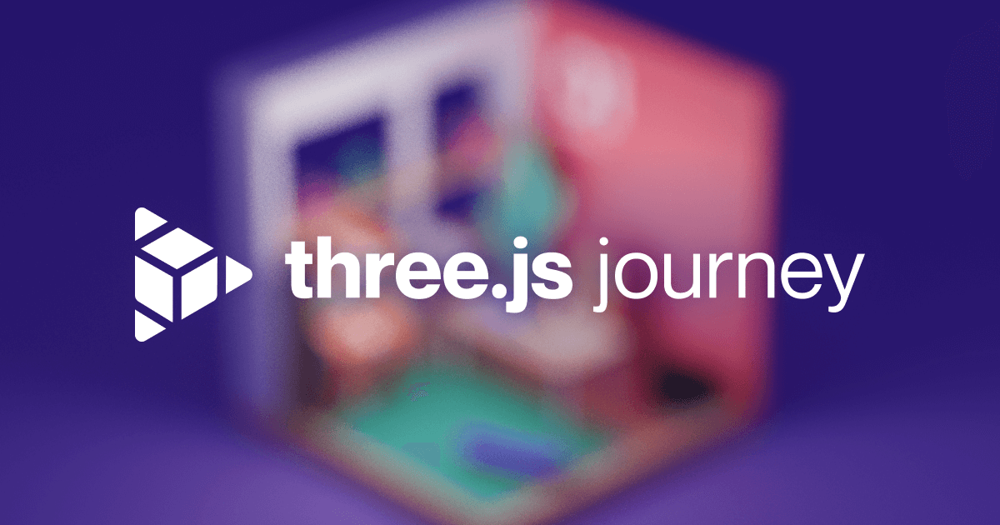

# Three.js Journey (Bruno Simon)

> **URL:** https://threejs-journey.com · **Type:** Course: three.js, WebGL, WebGPU, TSL · **Captured:** 2026-11-11
> 

## What it is
**87 lessons / 116 hours** from beginner to advanced: three.js basics, shaders (GLSL), **WebGPU + TSL**, R3F, physics (Rapier), Blender baking, performance, portal scene, particles, post-processing. Bruno Simon's own portfolio (bruno-simon.com, driveable car) is the canonical playful-3D reference.

## Catalog / structure
| Facet | Details |
| :--- | :--- |
| Chapters | Basics · Classic techniques · Advanced techniques · Shaders · Extra · Portal scene · React Three Fiber · WebGPU/TSL |

## What to borrow
- Source of truth for **baked lighting workflow** (Blender → GLB → three) used in `arch-*` skills.
- TSL lessons for future-proof shaders.

## API / MCP / access
—
