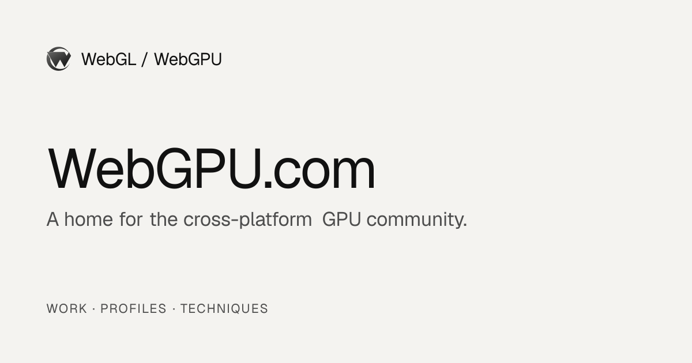

# WebGL.com / WebGPU.com

> **URL:** https://webgpu.com · **Type:** Real-time rendering showcase & news · **Captured:** 2026-11-11
> 

## What it is
Community showcase and news for WebGL/WebGPU with profiles and tags. Featured: **CHILE20** (Active Theory, three scroll-driven WebGL worlds for adidas, 500k-poly garments baked for mobile), **Igloo Inc** (Abeto — procedural ice crystals, shader-driven UI text, VDB particle footer), **Persepolis Reimagined** (Media.Monks × Getty), **Messenger** (Abeto, cel-shaded planet multiplayer game), FormulaZero (F1 time trials in WebGL2), Bricelab WebGPU concrete atrium, Bersus scroll-driven 3D portfolio, Mechanical Pianist.

## Catalog / structure
| Facet | Details |
| :--- | :--- |
| Sections | Showcase · News · Profiles · Tags · Submit · weekly newsletter |

## What to borrow
- Primary feed for `3d-research` and `game-research` subagents (add to their crawl list).
- Case write-ups explain asset budgets (baking, compression) — see [../../libraries/3d.md](../../libraries/3d.md) §6.

## API / MCP / access
No API; RSS likely.
